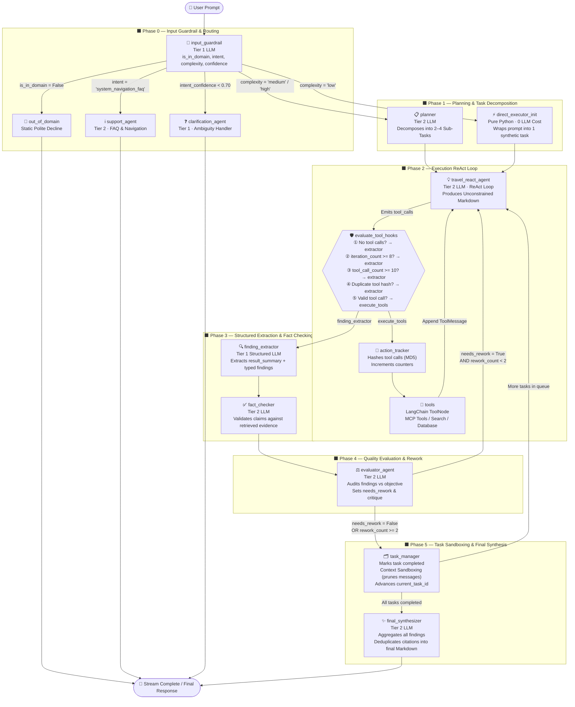

# 🧠 Cognitive Agent Engine — System Architecture & Workflow Specification

> **Framework:** LangGraph (`StateGraph`) · **Language:** Python 3.11+  
> **LLM Providers:** **9Router** (Multi-Cloud Proxy: OpenAI, Gemini, Claude, LLaMA, DeepSeek) · **vLLM** (Self-Hosted GPU Inference)  
> **Transports:** HTTP/1.1 Server-Sent Events (FastAPI port 8080) · HTTP/2 gRPC Streaming (port 50051)  
> **Vector DB & Cache:** Qdrant (Hybrid RAG + Semantic Cache) · Redis (Session Checkpointing)  

---

## 📑 Table of Contents

1. [Architectural Overview](#1-architectural-overview)
2. [Core Design Principles](#2-core-design-principles)
3. [AgentState — Shared Procedural Memory](#3-agentstate--shared-procedural-memory)
4. [Six-Phase Graph Lifecycle & Mermaid Diagram](#4-six-phase-graph-lifecycle--mermaid-diagram)
5. [Node Directory & Implementation Reference](#5-node-directory--implementation-reference)
6. [Conditional Routing & Programmatic Safeguards](#6-conditional-routing--programmatic-safeguards)
7. [LLM Provider Layer, Dynamic Tiers & Caching](#7-llm-provider-layer-dynamic-tiers--caching)
8. [Dual-Transport Streaming Engine (`ChatStreamService`)](#8-dual-transport-streaming-engine-chatstreamservice)
9. [Cryptographic Response Integrity (AI Receipts)](#9-cryptographic-response-integrity-ai-receipts)
10. [Infrastructure Container & Asynchronous Memory Pipeline](#10-infrastructure-container--asynchronous-memory-pipeline)
11. [Performance Benchmarking & Observability](#11-performance-benchmarking--observability)
12. [Documentation Directory Index](#12-documentation-directory-index)

---

## 1. Architectural Overview

The **Cognitive Agent Engine** is an enterprise-grade multi-agent reasoning and execution system built on LangGraph. Designed specifically for complex travel booking, flight/hotel comparison, itinerary construction, and customer support, it coordinates specialized autonomous nodes through a stateful directed graph.

The engine features interchangeable inference backends:
* **9Router Gateway** (`LLM_PROVIDER=nine_router`): An OpenAI-compatible gateway routing to top-tier commercial models (OpenAI GPT-4o, Anthropic Claude 3.5 Sonnet, Google Gemini 2.0, Meta LLaMA 3.3, DeepSeek R1).
* **vLLM Self-Hosted Engine** (`LLM_PROVIDER=vllm`): A dedicated GPU serving deployment (on local hardware or vast.ai) executing `Qwen2.5-3B-Instruct-AWQ` alongside `Qwen3-Embedding-4B` with continuous batching and PagedAttention.

Communication with downstream clients (such as the ASP.NET Core MVC web portal) occurs over two unified streaming transports:
* **HTTP SSE** (`POST /chat/stream`): Browser-friendly token streaming with real-time SSE events.
* **gRPC Streaming** (`AgentService.StreamChat` on port 50051): High-throughput binary streaming consumed by the website's SignalR `ChatHub` and microservices.

---

## 2. Core Design Principles

### 1. Two-Phase Generation & Structured Extraction Separation
Traditional ReAct agents often instruct the model to produce its final answer wrapped in a JSON envelope (`{"result": "..."}`). When generating rich markdown, quotes, tables, or code snippets, escaping failures routinely trigger catastrophic `JSONDecodeError` exceptions.

In this architecture, executors (`travel_react_agent`) output **natural, unconstrained Markdown**. Downstream, a dedicated `finding_extractor` node applies a tightly scoped Tier-1 structured LLM call with Pydantic schemas to distill factual findings (`List[Finding]`) and concise summaries. This guarantees 100% schema compliance and zero parse errors.

### 2. Complexity-Aware Routing & Cost Optimization
Not every user prompt requires deep multi-step planning:
* **Low-complexity queries** (e.g., "Find hotels in Da Nang under $100") bypass the Planner entirely via `direct_executor_init`, saving an entire round of high-cost LLM reasoning.
* **FAQ / Navigation queries** route to `support_agent` and exit immediately.
* **Ambiguous queries** with confidence < 0.70 trigger `clarification_agent` to solicit user clarification before consuming execution budget.
* **Medium/High complexity queries** (e.g., "Plan a 5-day cultural trip to Hue and Hoi An") trigger full hierarchical decomposition by `planner`.

### 3. Strict Anti-Drift Language Governance
When using multilingual open-weights models (such as Qwen 2.5), models can occasionally drift into Chinese tokens when analyzing multi-hop tool outputs. The engine enforces strict anti-drift directives injected into the master manifest ([`workflow.md`](workflow.md)) and system prompts across all nodes (`executor.py`, `extractor.py`, `planner.py`), guaranteeing output strictly in the detected user language (English or Vietnamese).

### 4. Deterministic Programmatic Safeguards
All loop termination, tool call budgets, and duplicate action checks are enforced **programmatically in conditional edge functions** rather than relying on model prompts. Even if an LLM hallucinates an infinite loop, code safeguards strictly terminate or advance execution.

### 5. Context Sandboxing Between Sub-Tasks
When executing sequential tasks, accumulated intermediate tool outputs can exhaust context windows. The `task_manager` clears intermediate conversational messages after completing each sub-task while injecting distilled findings from preceding tasks into the system prompt of subsequent tasks.

---

## 3. AgentState — Shared Procedural Memory

All nodes mutate and read from a unified `AgentState` (`TypedDict`), persisted across steps by LangGraph:

```python
class AgentState(TypedDict):
    # Core Message History (managed with add_messages reducer)
    messages: Annotated[Sequence[BaseMessage], add_messages]
    user_id: Optional[str]
    session_id: Optional[str]

    # Phase 0: Guardrail & Classification
    is_in_domain: Optional[bool]        # True if travel/booking related
    intent_category: Optional[str]      # 'hotel_booking', 'flight_booking', 'travel_faq', 'itinerary_planning'
    complexity: Optional[str]           # 'low', 'medium', 'high'
    objective: Optional[str]            # Overarching execution objective
    detected_language: Optional[str]    # Detected prompt language ('en', 'vi')
    intent_confidence: Optional[float]  # Classification confidence score (0.0 - 1.0)
    ambiguity_reason: Optional[str]     # Diagnostic notes if prompt is ambiguous

    # Token Governance & Cost Attribution
    tier1_input_tokens: Optional[int]
    tier1_output_tokens: Optional[int]
    tier2_input_tokens: Optional[int]
    tier2_output_tokens: Optional[int]
    estimated_cost_usd: Optional[float]

    # Procedural Task Management
    tasks: List[Dict[str, Any]]         # Sequential task queue from Planner
    current_task_id: Optional[int]      # Active task pointer

    # Safeguards & Loop Limits
    iteration_count: int                # ReAct loop counter for current task (max 8)
    tool_call_count: int                # Cumulative tool invocations across graph (max 10)
    action_history: List[str]           # MD5 hashes of prior tool invocations
    rework_count: int                   # Evaluator rework cycle counter (max 2)

    # Evaluation & Reflection
    evaluator_feedback: Optional[str]   # Specific critique for executor
    evaluator_notes: Optional[str]      # Internal reflection notes
    needs_rework: Optional[bool]        # Binary rework signal
    fact_check_result: Optional[Dict[str, Any]]
    final_answer: Optional[str]

    # Two-Phase Content & Extraction State
    raw_executor_output: Optional[str]       # Raw markdown output from executor
    extracted_findings: List[Dict[str, Any]] # Structured Pydantic findings

    # Cache Status
    cache_hit: Optional[bool]
```

---

## 4. Six-Phase Graph Lifecycle & Mermaid Diagram



---

## 5. Node Directory & Implementation Reference

Node logic is cleanly modularized under `app/graph/nodes/`:

| Module | Node Function | LLM Tier | Primary Responsibilities |
|---|---|---|---|
| [`guardrail.py`](app/graph/nodes/guardrail.py) | `node_input_guardrail` | Tier 1 | In-domain classification, intent categorization, complexity scoring (`low`/`medium`/`high`), language detection (`en`/`vi`). |
| [`planner.py`](app/graph/nodes/planner.py) | `node_planner_agent` | Tier 2 | Decomposes medium/high complexity goals into 2–4 sequential `TaskItem` objects. |
| [`planner.py`](app/graph/nodes/planner.py) | `node_direct_executor_init` | None (Code) | Zero-cost fast-path initialization for low-complexity queries (creates 1 synthetic task). |
| [`executor.py`](app/graph/nodes/executor.py) | `node_travel_react_agent` | Tier 2 | Core ReAct agent executing travel tools, querying hybrid RAG, synthesizing markdown answers. |
| [`executor.py`](app/graph/nodes/executor.py) | `node_support_agent` | Tier 2 | Answers general platform FAQs and website navigation queries directly. |
| [`executor.py`](app/graph/nodes/executor.py) | `node_clarification_agent` | Tier 1 | Formulates targeted follow-up questions when user intent confidence falls below 0.70. |
| [`extractor.py`](app/graph/nodes/extractor.py) | `node_finding_extractor` | Tier 1 | Extracts structured `ExecutorOutput` (`result_summary` + typed `List[Finding]`) from raw markdown. |
| [`evaluator.py`](app/graph/nodes/evaluator.py) | `node_fact_checker` | Tier 2 | Audits extracted claims against tool observations to eliminate hallucinations. |
| [`evaluator.py`](app/graph/nodes/evaluator.py) | `node_evaluator_agent` | Tier 2 | Assesses task satisfaction against the overarching objective; emits feedback and rework signals. |
| [`synthesizer.py`](app/graph/nodes/synthesizer.py) | `node_task_manager` | None (Code) | Iterates tasks, persists findings into state, performs **Context Sandboxing** to prevent prompt bloat. |
| [`synthesizer.py`](app/graph/nodes/synthesizer.py) | `node_final_synthesizer` | Tier 2 | Blends all task results, resolves conflicting citations, and outputs the final user response. |

The operational system prompt manifest is loaded dynamically from [`workflow.md`](workflow.md) and cached via `load_agent_manifest_instructions()` in `app/graph/utils.py`.

---

## 6. Conditional Routing & Programmatic Safeguards

### Edge Router Decisions

| Router Function | Source | Criteria | Destination |
|---|---|---|---|
| `route_from_guardrail` | `input_guardrail` | `not is_in_domain` | `out_of_domain` |
| | | `intent_confidence < 0.70` | `clarification_agent` |
| | | `intent == "system_navigation_faq"` | `support_agent` |
| | | `complexity == "low"` | `direct_executor_init` |
| | | Default (`medium` / `high`) | `planner` |
| `evaluate_tool_hooks` | `travel_react_agent` | No tool calls emitted | `finding_extractor` |
| | | `iteration_count >= 8` | `finding_extractor` *(forced stop)* |
| | | `tool_call_count >= 10` | `finding_extractor` *(budget stop)* |
| | | MD5 tool call hash already in `action_history` | `finding_extractor` *(duplicate stop)* |
| | | Valid unique tool call | `action_tracker` → `tools` |
| `route_from_evaluator` | `evaluator_agent` | `needs_rework == True` AND `rework_count < 2` | `travel_react_agent` *(rework loop)* |
| | | `needs_rework == False` OR `rework_count >= 2` | `task_manager` *(advance)* |
| `route_from_task_manager` | `task_manager` | `current_task_id is not None` | `travel_react_agent` *(next task)* |
| | | `current_task_id is None` | `final_synthesizer` *(finish)* |

### Programmatic Safeguards Summary

* **Max ReAct Iterations (`MAX_ITERATIONS = 8`)**: Prevents an executor from looping endlessly within a single task.
* **Max Tool Call Budget (`MAX_TOOL_CALLS = 10`)**: Caps total cumulative external queries per request to avoid billing drain.
* **Action Deduplication**: Computes an MD5 hash over `tool_name + sorted(args.items())`. Redundant queries are intercepted and terminated.
* **Max Rework Cycles (`MAX_REWORK_CYCLES = 2`)**: Guarantees that strict evaluator critiques never block final response delivery indefinitely.
* **Graph Recursion Limit (`recursion_limit = 100`)**: Configured in `chat_stream_service.py` and `grpc_server.py` to prevent premature graph termination on multi-step plans.

---

## 7. LLM Provider Layer, Dynamic Tiers & Caching

The engine supports dynamic LLM instantiation via `app/graph/config.py`:

### Tier Architecture

| Tier | Profile | 9Router Model | vLLM Model | Target Workloads |
|---|---|---|---|---|
| **Tier 1** | Fast, ultra-low latency & cost | `gpt-4o-mini` | `Qwen2.5-3B-Instruct-AWQ` | Guardrail classification, finding extraction, clarification |
| **Tier 2** | Balanced reasoning & tool usage | `gpt-4o` | `Qwen2.5-3B-Instruct-AWQ` | Planner, ReAct execution, evaluator, fact checker, synthesizer |
| **Tier 3** | Deep reasoning | `o1-mini` | High-parameter model | High-complexity algorithmic travel synthesis |

### High-Performance Three-Level Caching
To eliminate cold-start compilation overhead and JSON schema translation penalties:
1. `_LLM_INSTANCE_CACHE`: Retains base `ChatOpenAI` instances keyed by `(provider, model_name, api_key_hash, temperature)`.
2. `_STRUCTURED_LLM_CACHE`: Caches `.with_structured_output(schema)` compiled runnables.
3. `_BOUND_LLM_CACHE`: Caches MCP tool-bound LLM runnables in $O(1)$ time.
4. **Cache Invalidation Guard**: A settings fingerprint hash invalidates all cache entries automatically when configuration keys change.

---

## 8. Dual-Transport Streaming Engine (`ChatStreamService`)

Both the REST API (`POST /chat/stream`) and gRPC Server (`AgentService.StreamChat`) share an identical streaming pipeline defined in `app/services/streaming/chat_stream_service.py`:

```
User Query
    │
    ▼
[ChatStreamService.stream()]
    │
    ├── 1. Semantic Cache Check (Qdrant ANN Cosine Similarity)
    │      └─ Hit? ──► Instant stream delivery (TTFT < 50ms) ──► Complete
    │
    ├── 2. Initialize AgentState & Graph Runner
    │
    ├── 3. Stream LangGraph Events (tokens, tool dispatches)
    │      ├─ HTTP SSE: Emits text/event-stream chunks
    │      └─ gRPC: Emits binary chat_pb2.ChatResponse chunks
    │
    ├── 4. Generate ECDSA AI Response Receipt (SECP256R1)
    │
    └── 5. Publish Async Fact Extraction Task (RabbitMQ)
```

---

## 9. Cryptographic Response Integrity (AI Receipts)

To ensure B2B enterprise auditability and verifiable AI provenance, every streamed response finishes with an **ECDSA (SECP256R1) Digital Receipt**:

$$\text{Data To Sign} = \text{session\_id} + ":" + \text{timestamp} + ":" + \text{SHA256}(\text{full\_ai\_response})$$

* **Private Key**: Configured via `SECURITY_AI_RECEIPT_PRIVATE_KEY` (kept strictly in agent backend).
* **Public Key**: Accessible to client applications (ASP.NET website, external auditors) to verify response authenticity.
* Delivered as the final payload in both SSE (`event: receipt`) and gRPC (`chat_pb2.Receipt`).

---

## 10. Infrastructure Container & Asynchronous Memory Pipeline

The shared `Container` (`app/bootstrap/container.py`) bootstraps singletons on startup:

* **Redis Client**: Manages conversation session checkpointing via `AsyncRedisSaver`.
* **Embedding Provider**: Encapsulates dense vector generation (`text-embedding-3-small` or `Qwen3-Embedding-4B`).
* **Qdrant Vector Database**:
  * `long_term_memory` / `long_term_memory_vllm`: User preference storage.
  * `hotels_collection` / `hotels_collection_vllm`: Knowledge base for hybrid retrieval.
  * `semantic_cache`: Fast-path response cache.
* **Hybrid Retriever**: Combines dense vector search with sparse BM25 keyword matching and Reciprocal Rank Fusion (RRF).
* **RabbitMQ Memory Worker**: After every completed conversation, a payload is published to RabbitMQ. The background `MemoryWorker` runs factual extraction and upserts persistent user preferences into Qdrant asynchronously without impacting response latency.

---

## 11. Performance Benchmarking & Observability

The Agent Engine provides built-in enterprise observability:
* **Prometheus Metrics**: Detailed metrics across 8 functional groups (see [`docs/metrics_tracking.md`](docs/metrics_tracking.md)).
* **Grafana Dashboards**:
  * `k6_load_test_dashboard.json`: Concurrency, p95 latencies, TTFT, chunk rates.
  * `vllm_dashboard.json`: GPU memory usage, KV cache utilization, continuous batching efficiency.
* **k6 Performance Test Suite**: Automated load testing across SSE and gRPC from 10 to 1000 concurrent Virtual Users (see [`docs/PERFORMANCE_TEST_GUIDE.md`](docs/PERFORMANCE_TEST_GUIDE.md)).

---

## 12. Documentation Directory Index

| Document | Path | Description |
|---|---|---|
| **System Workflow Manifest** | [`workflow.md`](workflow.md) | Master supervisor operational manifest and anti-drift rules. |
| **Metrics Tracking Reference** | [`docs/metrics_tracking.md`](docs/metrics_tracking.md) | Exhaustive catalog of all Prometheus gauges, counters, and histograms. |
| **Performance Testing Guide** | [`docs/PERFORMANCE_TEST_GUIDE.md`](docs/PERFORMANCE_TEST_GUIDE.md) | Step-up, smoke, soak, and spike load test instructions with k6. |
| **vLLM vast.ai Deployment** | [`docs/vast_setup_vllm.md`](docs/vast_setup_vllm.md) | Dual-model GPU deployment (LLM + Embedding) on vast.ai RTX 3090. |
| **Structured Output Guide** | [`docs/structured_output_design_guide.md`](docs/structured_output_design_guide.md) | Architectural rationale for two-phase generation/extraction separation. |
| **Service Ports & Endpoints** | [`docs/api_document.md`](docs/api_document.md) | Host ports, endpoints, and credentials for all Docker services. |
