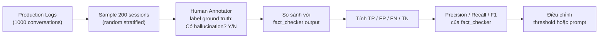

# 🧮 Confusion Matrix — Áp Dụng Cho Hệ Thống LLM Agent

> Tài liệu này ghi lại nội dung thảo luận về cách tư duy Confusion Matrix trong bối cảnh kiểm soát chất lượng của Travel Booking Agent.

---

## 1. Khung Tư Duy Cốt Lõi

Bất kỳ node nào trong hệ thống đưa ra **phán quyết nhị phân** (có/không, lỗi/ổn, cần rework/không cần) đều có thể được đánh giá bằng Confusion Matrix.

```
                    ┌─────────────────────────────────────────────┐
                    │           THỰC TẾ (Ground Truth)            │
                    ├─────────────────────┬───────────────────────┤
                    │   CÓ vấn đề thật    │  KHÔNG có vấn đề thật │
    ┌───────────────┼─────────────────────┼───────────────────────┤
    │  Hệ thống     │                     │                       │
    │  báo:         │  ✅ True Positive   │  ❌ False Positive    │
    │  CÓ vấn đề   │       (TP)          │       (FP)            │
    ├───────────────┼─────────────────────┼───────────────────────┤
    │  Hệ thống     │                     │                       │
    │  báo:         │  ❌ False Negative  │  ✅ True Negative     │
    │  KHÔNG có     │       (FN)          │       (TN)            │
    └───────────────┴─────────────────────┴───────────────────────┘
```

### Định Nghĩa 4 Ô

| Ký hiệu | Tên đầy đủ | Ý nghĩa đơn giản |
|---|---|---|
| **TP** | True Positive | Có lỗi thật → Hệ thống **bắt đúng** |
| **TN** | True Negative | Không có lỗi → Hệ thống **xác nhận đúng** |
| **FP** | False Positive | Không có lỗi thật → Hệ thống **báo nhầm** là có |
| **FN** | False Negative | Có lỗi thật → Hệ thống **bỏ sót**, không phát hiện |

> [!CAUTION]
> **False Negative thường nguy hiểm hơn False Positive** trong hệ thống AI an toàn — bỏ sót lỗi (FN) gây hậu quả thực tế, còn báo nhầm (FP) chỉ gây tốn tài nguyên.

---

## 2. Áp Dụng Vào Từng Node Của Travel Booking Agent

### 2.1 `node_fact_checker`
> **Câu hỏi phán quyết:** *"Response có bị hallucinate / mâu thuẫn với data không?"*

```
                    ┌──────────────────────┬──────────────────────┐
                    │ Thực tế: CÓ          │ Thực tế: KHÔNG       │
                    │ hallucination        │ hallucination        │
    ┌───────────────┼──────────────────────┼──────────────────────┤
    │ Báo: CÓ       │ ✅ TP               │ ❌ FP                │
    │ hallucination  │ Bắt đúng lỗi        │ Từ chối response tốt │
    ├───────────────┼──────────────────────┼──────────────────────┤
    │ Báo: KHÔNG    │ ❌ FN  ← NGUY HIỂM  │ ✅ TN               │
    │ hallucination  │ Bỏ sót lỗi thật     │ Xác nhận đúng        │
    └───────────────┴──────────────────────┴──────────────────────┘
```

**Hậu quả của từng loại lỗi:**

| Loại lỗi | Hậu quả nghiệp vụ | Mức độ |
|---|---|---|
| **FN** (bỏ sót hallucination) | User nhận thông tin sai về giá/phòng → booking lỗi, mất tin tưởng | 🔴 Nghiêm trọng |
| **FP** (báo nhầm response tốt) | Trigger rework không cần thiết → tốn LLM tokens, tăng latency | 🟡 Khó chịu |

#### ⚠️ Bug Được Phát Hiện — False Negative Cấu Trúc

```python
# evaluator.py — line 33-37
if not tool_observations:
    return {
        "is_consistent": True,     # ← Phán quyết: "Không có vấn đề"
        "consistency_score": 1.0   # ← Với mức tự tin tuyệt đối 100%
    }
```

**Kịch bản dẫn đến FN:**

```
User hỏi:
  "Khách sạn Grand có hồ bơi không?"

support_agent trả lời (không gọi tool):
  "Có, Grand Hotel có hồ bơi Olympic tiêu chuẩn quốc tế."
  ↑ Thông tin này bị HALLUCINATE — không có gì xác nhận

tool_observations = []   ← Không có tool nào được gọi

fact_checker:
  "Không có observations → is_consistent = True, score = 1.0"
  ↑ FALSE NEGATIVE — có lỗi thật nhưng báo là ổn

Kết quả:
  Hallucination thoát ra production mà không bị phát hiện
```

**Fix đề xuất:**
```python
if not tool_observations:
    # Phân biệt rõ: "không thể verify" ≠ "đã verify và ổn"
    return {
        "is_consistent": None,          # None = unverifiable
        "consistency_score": None,      # Không emit vào avg metrics
        "verification_status": "no_tool_data",
        "contradictions": [],
        "ungrounded_claims": []
    }
```

---

### 2.2 `node_input_guardrail`
> **Câu hỏi phán quyết:** *"Request có thuộc domain travel không?"*

```
                    ┌──────────────────────┬──────────────────────┐
                    │ Thực tế: IN domain   │ Thực tế: OUT domain  │
    ┌───────────────┼──────────────────────┼──────────────────────┤
    │ Báo: IN       │ ✅ TP               │ ❌ FP                │
    │               │ Xử lý đúng request   │ Xử lý request OOD   │
    ├───────────────┼──────────────────────┼──────────────────────┤
    │ Báo: OUT      │ ❌ FN               │ ✅ TN               │
    │               │ Từ chối user hợp lệ  │ Chặn đúng OOD       │
    └───────────────┴──────────────────────┴──────────────────────┘
```

**Hậu quả:**

| Loại lỗi | Hậu quả |
|---|---|
| **FP** (nhận request OOD) | Tốn token xử lý vô ích, có thể trả lời sai lĩnh vực |
| **FN** (từ chối user hợp lệ) | User frustration, churn — tệ hơn cho business |

> [!TIP]
> Với guardrail, nên **ưu tiên FP thấp** (không để lọt OOD request) nhưng đặt `intent_confidence_threshold` đủ thấp để không từ chối nhầm user hợp lệ.

---

### 2.3 `node_evaluator_agent`
> **Câu hỏi phán quyết:** *"Executor output có cần rework không?"*

```
                    ┌──────────────────────┬──────────────────────┐
                    │ Thực tế: CẦN rework  │ Thực tế: KHÔNG cần  │
    ┌───────────────┼──────────────────────┼──────────────────────┤
    │ Báo: CẦN      │ ✅ TP               │ ❌ FP                │
    │               │ Trigger đúng rework  │ Rework thừa, đắt tiền│
    ├───────────────┼──────────────────────┼──────────────────────┤
    │ Báo: KHÔNG    │ ❌ FN               │ ✅ TN               │
    │               │ Bỏ qua response tệ  │ Thông qua response tốt│
    └───────────────┴──────────────────────┴──────────────────────┘
```

**Rủi ro đặc thù — Self-Enhancement Bias:**

```
evaluator_agent dùng cùng LLM tier 2 để chấm điểm output của tier 2
→ Model tự chấm điểm cao cho chính mình (sycophancy bias)
→ FN tăng cao một cách có hệ thống
→ Nhiều response tệ được "bỏ qua" mà không rework
```

**Fix:** Dùng model khác (provider khác hoặc tier khác) làm judge.

---

## 3. Precision vs Recall — Trade-off Quan Trọng Nhất

### Công Thức

$$\text{Precision} = \frac{TP}{TP + FP}$$

> Trong số **những lần hệ thống báo lỗi**, bao nhiêu % là lỗi thật?
> → Đo độ **đáng tin** của cảnh báo.

$$\text{Recall} = \frac{TP}{TP + FN}$$

> Trong số **tất cả lỗi thật**, bao nhiêu % được phát hiện?
> → Đo độ **bao phủ** của bộ phát hiện.

$$\text{F1} = 2 \times \frac{\text{Precision} \times \text{Recall}}{\text{Precision} + \text{Recall}}$$

> Điểm cân bằng giữa hai chiều.

---

### Trade-off Trong Thực Tế

```
Tăng threshold phát hiện  →  Precision ↑,  Recall ↓
  (chỉ báo khi chắc chắn)       (ít báo nhầm)  (bỏ sót nhiều hơn)

Giảm threshold phát hiện  →  Precision ↓,  Recall ↑
  (báo mọi nghi ngờ)           (nhiều báo nhầm)  (ít bỏ sót hơn)
```

### Chiến Lược Cho Từng Node

```
┌─────────────────────────┬──────────────────┬───────────────────────────┐
│ Node                    │ Ưu tiên          │ Lý do                     │
├─────────────────────────┼──────────────────┼───────────────────────────┤
│ fact_checker            │ Recall cao       │ Thà báo nhầm 1 response   │
│                         │ (≥ 0.90)         │ tốt hơn bỏ sót 1 lỗi     │
├─────────────────────────┼──────────────────┼───────────────────────────┤
│ input_guardrail         │ Precision cao    │ Không để lọt OOD request  │
│                         │ (≥ 0.95)         │ vào hệ thống              │
├─────────────────────────┼──────────────────┼───────────────────────────┤
│ evaluator_agent         │ Cân bằng F1      │ FP tốn token, FN giảm    │
│                         │                  │ quality — cần cân nhắc    │
└─────────────────────────┴──────────────────┴───────────────────────────┘
```

---

## 4. Cách Đo Confusion Matrix Trong Thực Tế

Để tính được TP/FP/FN/TN, bạn cần **ground truth** — đây chính là lý do cần **Golden Dataset** và **Human Review**.

### Quy Trình Đo



### Ví Dụ Tính Toán

Giả sử sample 200 conversations, human annotator label xong:

```
fact_checker báo "có hallucination":   50 cases
  → Human confirm đúng (TP):           42
  → Human thấy sai (FP):                8

fact_checker báo "không vấn đề":      150 cases
  → Thực ra ổn (TN):                  141
  → Thực ra có lỗi — bỏ sót (FN):      9

Precision = 42 / (42 + 8)  = 0.84  (84% cảnh báo là đúng)
Recall    = 42 / (42 + 9)  = 0.82  (82% lỗi thật được bắt)
F1        = 2 × (0.84 × 0.82) / (0.84 + 0.82) = 0.83
```

> [!NOTE]
> Recall 0.82 với fact_checker là **chưa đủ** cho hệ thống booking — mỗi 100 lỗi thật vẫn có 18 cái thoát ra user. Mục tiêu nên là Recall ≥ 0.90.

---

## 5. Kết Nối Với Human-in-the-Loop

Human Review không chỉ để **sửa lỗi từng case**, mà còn để **đo độ chính xác của chính bộ checker**:

```
Vòng lặp cải tiến:

  Human Review  →  Tạo Ground Truth  →  Đo Confusion Matrix
       ↑                                        │
       │                                        ↓
  Điều chỉnh         ←─────────────────  Phát hiện điểm yếu
  threshold/prompt                       (FN quá cao? FP quá cao?)
```

**Tín hiệu cần theo dõi trên dashboard:**

| Metric Prometheus | Ý nghĩa Confusion Matrix |
|---|---|
| `agent_hallucination_detected_total` | Proxy cho TP + FP của fact_checker |
| `agent_forced_accept_total` | Proxy cho FN của evaluator (bỏ qua response tệ) |
| `agent_rework_triggered_total` | TP + FP của evaluator (gộp) |
| Human score từ Langfuse `= 0` (reject) | Ground truth FN — lỗi đã thoát ra |

---

## 6. Tóm Tắt Nhanh

```
┌───────────────────────────────────────────────────────────────┐
│                    CHEAT SHEET                                │
├──────────────┬────────────────────────────────────────────────┤
│ True Positive│ Có lỗi thật, bắt được → ĐÚNG                  │
│ True Negative│ Không có lỗi, xác nhận ổn → ĐÚNG              │
│ False Positive│ Không có lỗi, báo nhầm là có → TỐN TÀI NGUYÊN│
│ False Negative│ Có lỗi thật, bỏ sót → NGUY HIỂM NHẤT         │
├──────────────┼────────────────────────────────────────────────┤
│ Precision    │ Cảnh báo đáng tin đến đâu? TP/(TP+FP)          │
│ Recall       │ Bắt được bao nhiêu % lỗi thật? TP/(TP+FN)      │
│ F1           │ Điểm cân bằng giữa Precision và Recall         │
├──────────────┼────────────────────────────────────────────────┤
│ fact_checker │ Ưu tiên Recall cao (bắt hết lỗi)               │
│ guardrail    │ Ưu tiên Precision cao (ít báo nhầm)             │
│ evaluator    │ Cân bằng F1 (rework tốn kém, bỏ sót cũng tệ)  │
└──────────────┴────────────────────────────────────────────────┘
```
