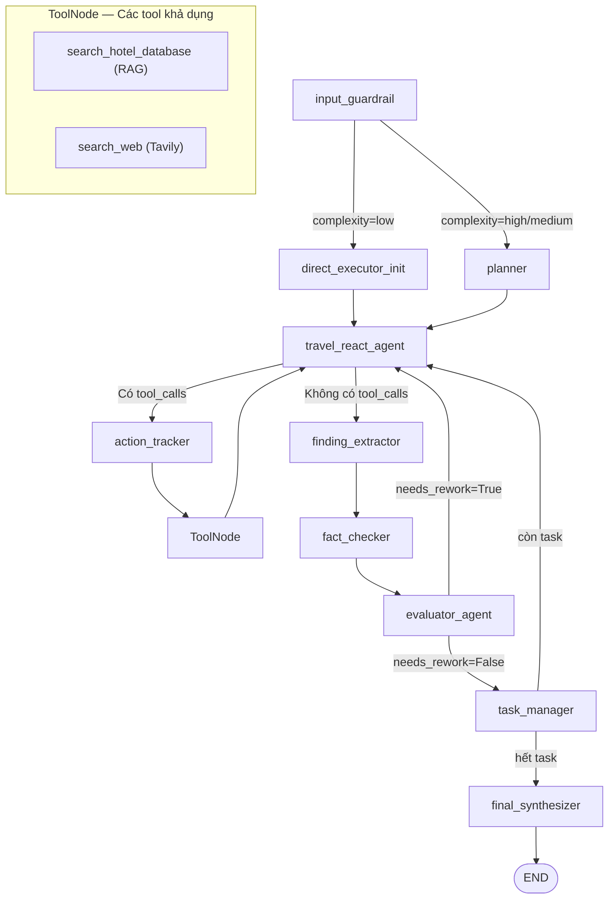

# Phân tích luồng RAG + LLM trong hệ thống

## Kết luận ngắn gọn

> [!IMPORTANT]
> Hệ thống **KHÔNG** có luồng RAG-then-LLM truyền thống. Thay vào đó, RAG được tích hợp **bên trong** vòng lặp ReAct của LLM dưới dạng một **Tool**. LLM **tự quyết định** khi nào cần gọi RAG.

---

## Luồng hiện tại: RAG-as-Tool trong ReAct Loop



---

## Chi tiết từng bước

### 1. `travel_react_agent` — LLM với tools được bind sẵn

**File:** [`executor.py` L109–L174](file:///c:/Users/tuanm/OneDrive/project2/Booking/agent/app/graph/nodes/executor.py#L109-L174)

```python
# LLM được bind tools = [search_hotel_database (RAG), search_web]
base_llm = get_llm_instance(2, config)
llm_with_tools = get_cached_bound_llm("travel", base_llm)
```

LLM nhận System Prompt dạng ReAct:
1. **THOUGHT** → LLM suy nghĩ có cần dữ liệu ngoài không
2. **ACTION** → Nếu cần, gọi tool (RAG hoặc web search)
3. **OBSERVATION** → Nhận kết quả tool
4. **FINAL ANSWER** → Tổng hợp câu trả lời

---

### 2. `search_hotel_database` — Chính là RAG

**File:** [`local_tools.py` L7–L52](file:///c:/Users/tuanm/OneDrive/project2/Booking/agent/app/mcp/local_tools.py#L7-L52)

```python
# RAG pipeline bên trong tool:
optimized_query = await transform_user_query(raw_query)   # Query rewriting
dense_embedding = await container.embedding_provider.embed(optimized_query)  # Embed
hotels = await container.hotel_store.hybrid_search_hotels(...)  # Hybrid search (Dense + BM25)
# → Trả về formatted text chunks cho LLM
```

RAG ở đây sử dụng **Hybrid Search** (Dense + BM25 → RRF fusion).

---

### 3. `ToolNode` và vòng lặp quay về LLM

**File:** [`workflow.py` L232–L238](file:///c:/Users/tuanm/OneDrive/project2/Booking/agent/app/graph/workflow.py#L232-L238)

```
travel_react_agent → [evaluate_tool_hooks]
    ├── có tool_calls → action_tracker → ToolNode → travel_react_agent (lặp lại)
    └── không có tool_calls → finding_extractor → ...
```

Sau khi tool trả về kết quả, **message được thêm vào history** và LLM được gọi lại với đầy đủ context (bao gồm cả kết quả RAG). **Đây chính là cơ chế kết hợp RAG + LLM.**

---

## So sánh 2 mô hình

| Tiêu chí | Mô hình truyền thống | Hệ thống hiện tại |
|---|---|---|
| **Luồng** | RAG → LLM (cố định) | LLM → (tự quyết) → RAG → LLM |
| **Điều kiện gọi RAG** | Luôn gọi trước | LLM tự quyết dựa trên context |
| **Số lần gọi RAG** | 1 lần duy nhất | Có thể 0, 1, hoặc nhiều lần |
| **Kết hợp web search** | Thường riêng biệt | Cùng một vòng lặp với RAG |
| **RAG nằm ở đâu** | Node riêng biệt | Bên trong ToolNode |

---

## Vấn đề bạn đặt ra: "Thiếu cơ chế kết hợp?"

> [!NOTE]
> **Không thiếu**, nhưng được thiết kế theo cách **khác với RAG truyền thống**.

**Cơ chế kết hợp hiện tại (Implicit RAG-LLM fusion):**
- Kết quả của `search_hotel_database` được append vào **message history** dưới dạng `ToolMessage`
- Khi LLM được gọi lại (iteration tiếp theo), nó nhận **toàn bộ context** bao gồm cả RAG results
- LLM "tổng hợp" RAG + reasoning trong cùng một lần sinh final answer

**Điểm khác biệt so với RAG-then-LLM truyền thống:**
- ✅ Linh hoạt hơn: LLM có thể gọi RAG 0 lần (nếu đủ knowledge) hoặc nhiều lần (refinement)
- ✅ Multi-source: Có thể kết hợp RAG + Web Search trong cùng context
- ⚠️ Khó kiểm soát hơn: Không đảm bảo LLM luôn gọi RAG trước khi trả lời
- ⚠️ Chi phí token cao hơn vì phải maintain full message history

---

## Điểm cần chú ý

> [!WARNING]
> **LLM có thể không gọi RAG** nếu nó nghĩ rằng đã có đủ thông tin từ System Prompt hoặc conversation history. Điều này xảy ra khi System Prompt có câu:
> ```
> "CRITICAL RULE: CRITIC BEFORE TOOL. Do I actually need external data, or can I deduce it from context?"
> ```
> → LLM được khuyến khích **bỏ qua tool** nếu có thể suy luận từ context. Với các câu hỏi về hotel, đây có thể là rủi ro hallucination.

