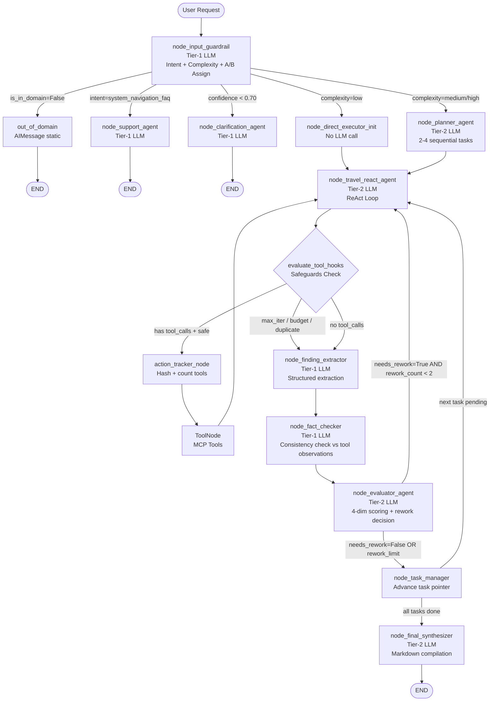

# 📋 Báo Cáo Đánh Giá Kiến Trúc: Travel Booking Agent System

> **Phạm vi đánh giá:** Source code tại `C:\Users\tuanm\OneDrive\project2\Booking\agent`
> **Ngày:** 05/11/2026 | **Phiên bản source:** Hiện tại

---

## 1. Tổng Quan Kiến Trúc Hiện Tại

### 1.1 Stack Công Nghệ

| Thành phần | Công nghệ |
|:---|:---|
| **Orchestration Framework** | LangGraph (StateGraph) |
| **LLM Provider** | 9Router (OpenAI-compatible proxy) / vLLM (self-hosted) |
| **LLM Tiers** | Tier 1: `gpt-4o-mini` (fast/cheap) · Tier 2: `gpt-4o` (balanced) · Tier 3: `o1-mini` (reasoning) |
| **Vector DB** | Qdrant (Hybrid: Dense + BM25 + RRF fusion) |
| **Cache** | Redis (Semantic cache + Session state) |
| **Message Queue** | RabbitMQ (fact extraction queue) |
| **Tracing / Eval Bridge** | Langfuse |
| **Observability** | Prometheus + Grafana |
| **Transport** | FastAPI (SSE streaming) + gRPC |
| **Tool Protocol** | MCP (Model Context Protocol) |

### 1.2 Toàn Bộ Luồng Workflow (Dạng Graph)



---

## 2. Phân Tích Chi Tiết Từng Node

### 2.1 `node_input_guardrail` — Cổng Vào

**Chức năng:** Phân loại intent, complexity, detect ngôn ngữ, assign A/B variant.

| Khía cạnh | Đánh giá |
|:---|:---|
| **Routing logic** | ✅ Tốt — 5 nhánh phân tách rõ ràng (OOD, Support, Clarification, Direct, Planner) |
| **A/B Testing** | ✅ Tốt — MD5 hash trên `session_id`, deterministic, 10% traffic vào model_b |
| **Fallback** | ⚠️ Rủi ro — Exception fallback cứng code `complexity=low`, `travel_faq` không log nguyên nhân lỗi đầy đủ |
| **Confidence threshold** | ✅ Tốt — `< 0.70` trigger clarification agent |
| **Token limit** | ⚠️ Chú ý — `max_tokens=500` cho structured JSON, cần monitor truncation |

**Vấn đề phát hiện:**
- Schema `InputGuardrailOutput` không có field `flight_booking` trong enum `intent_category`, nhưng `workflow.md` đề cập "FLIGHT BOOKING". Intent này sẽ rơi vào `travel_faq` hoặc `ambiguous` — **lỗ hổng routing**.
- Khi exception xảy ra, `objective` không được set → downstream nodes nhận `objective = "Provide a comprehensive answer."` — **quá generic**.

---

### 2.2 `node_planner_agent` — Phân Rã Nhiệm Vụ

**Chức năng:** Tier-2 LLM chia query phức tạp thành 2-4 sub-tasks tuần tự.

| Khía cạnh | Đánh giá |
|:---|:---|
| **Structured output** | ✅ Tốt — Pydantic `PlannerOutput` đảm bảo parse an toàn |
| **Language enforcement** | ✅ Tốt — Inject `detected_language` vào prompt |
| **Fallback** | ✅ Chấp nhận được — Single task fallback khi parse fail |
| **Task count cứng** | ⚠️ Chú ý — Giới hạn 2-4 tasks là hardcode trong prompt, không configurable |
| **Cost** | ⚠️ Chú ý — Dùng Tier-2 cho planner có thể dùng Tier-1 nếu task đơn giản |

---

### 2.3 `node_travel_react_agent` — Executor Chính

**Chức năng:** ReAct loop, gọi MCP tools, produce final Markdown answer.

| Khía cạnh | Đánh giá |
|:---|:---|
| **Message sanitization** | ✅ Rất tốt — `_sanitize_orphaned_tool_calls()` xử lý edge case khi safeguard ngắt mid-loop |
| **Context pruning** | ✅ Tốt — `prune_messages_by_token_limit()` theo max_context |
| **Language drift guard** | ✅ Tốt — Explicit anti-Chinese prompt injection |
| **Soft-stop reminder** | ✅ Tốt — Inject `COMPACT_AGENT_REMINDER` từ iteration 2 trở đi |
| **Token limit** | ⚠️ Thấp — `max_tokens=800` cho agent chính có thể quá chật cho itinerary dài |

---

### 2.4 `evaluate_tool_hooks` — Safeguard Router

**Chức năng:** Kiểm tra max_iterations, budget, duplicate tool calls trước khi execute.

| Khía cạnh | Đánh giá |
|:---|:---|
| **Max iterations** | ✅ Tốt — Giới hạn 8 vòng |
| **Budget cap** | ✅ Tốt — Giới hạn 10 tool calls |
| **Duplicate detection** | ✅ Rất tốt — MD5 hash của `(tool_name, args)`, O(1) lookup |
| **Metrics** | ✅ Tốt — `FORCED_TERMINATION_TOTAL` label đủ dimension |
| **Logic gap** | ⚠️ Rủi ro — Duplicate check chỉ detect **exact duplicate**. Semantic duplicate (cùng intent, args hơi khác) không bị block |

---

### 2.5 `node_finding_extractor` — Tách Cấu Trúc

**Chức năng:** Dùng Tier-1 LLM chuyển Markdown tự do → `result_summary` + `List[Finding]` có confidence score.

| Khía cạnh | Đánh giá |
|:---|:---|
| **Thiết kế** | ✅ Rất tốt — Giải quyết đúng vấn đề `JSONDecodeError` khi executor output chứa code blocks |
| **Cost efficiency** | ✅ Tốt — Dùng Tier-1 (cheap/fast) phù hợp cho extraction task |
| **Confidence scoring** | ✅ Tốt — `0.0 → 1.0` per finding, dùng để mark "(⚠️ Unverified)" |
| **Fallback** | ⚠️ Chú ý — Fallback về `raw_summary = executor_raw` (toàn bộ text) → extractor tiếp theo nhận payload rất lớn |

---

### 2.6 `node_fact_checker` — Kiểm Chứng Thực Tế

**Chức năng:** So sánh `extracted_findings` với raw `ToolMessage` observations để phát hiện hallucination.

| Khía cạnh | Đánh giá |
|:---|:---|
| **Cơ chế** | ✅ Đúng hướng — Dùng tool observations làm ground truth |
| **Phạm vi check** | ⚠️ Giới hạn — Chỉ check claims vs tool data. Nếu tool cũng trả data sai (nguồn không đáng tin) → fact-checker pass nhưng response vẫn sai |
| **No-tool path** | ✅ Tốt — Trả `verification_status="no_tool_data"` thay vì fake score |
| **Truncation** | ⚠️ Rủi ro — Cắt `raw_obs_str` tại 4000 chars: có thể mất data quan trọng cuối string |
| **Latency** | ⚠️ Nặng — Tier-1 LLM call + toàn bộ tool observations → `~1-2s` trên hot-path |
| **Feedback propagation** | ⚠️ Chú ý — `evaluator_feedback` bị overwrite bởi fact_checker rồi lại bị overwrite bởi evaluator_agent → fact_check feedback có thể bị mất |

---

### 2.7 `node_evaluator_agent` — Chấm Điểm & Quyết Định Rework

**Chức năng:** LLM-as-a-Judge, 4-dim scoring (tool quality, evidence, citation, freshness), quyết định `needs_rework`.

| Khía cạnh | Đánh giá |
|:---|:---|
| **4-dimension scoring** | ✅ Tốt — Phân tách rõ 4 chiều, forward sang Langfuse |
| **Rework cap** | ✅ Tốt — `max_rework_cycles=2`, prevent infinite loop |
| **Forced accept flag** | ✅ Rất tốt — `forced_accept=True` signal cho human review qua Langfuse |
| **Scoring subjectivity** | ⚠️ Rủi ro lớn — LLM chấm điểm cho chính output của LLM khác: không có ground truth, scores có thể biến động lớn giữa các lần chạy |
| **Rework instruction** | ⚠️ Chú ý — `actionable_advice` được inject vào state nhưng **không được chuyển vào context** của `travel_react_agent` khi rework. Agent không thực sự "biết" mình cần sửa gì |
| **Cost overhead** | ⚠️ Nặng — Tier-2 LLM cho evaluator, chạy cho MỌI task dù task đơn giản |

---

### 2.8 `node_task_manager` — Quản Lý Task Loop

**Chức năng:** Đánh dấu task hoàn thành, context sandboxing, advance con trỏ task.

| Khía cạnh | Đánh giá |
|:---|:---|
| **Context sandboxing** | ✅ Rất tốt — `RemoveMessage` xóa execution messages, giữ sạch context cho task tiếp theo |
| **Reset counters** | ✅ Tốt — Reset `iteration_count`, `tool_call_count`, `rework_count` per task |
| **State decoupling** | ✅ Tốt — Đọc từ `raw_executor_output` thay vì parse JSON từ messages |
| **Logic gap** | ⚠️ Chú ý — Nếu `current_task_id` không match bất kỳ task nào (data corruption), task sẽ không bao giờ được đánh dấu complete → vòng lặp vô tận (blocked bởi MAX_REWORK nhưng không bởi MAX_ITERATIONS vì counters đã reset) |

---

### 2.9 `node_final_synthesizer` — Biên Soạn Phản Hồi

**Chức năng:** Compile tất cả task findings → Markdown response cuối cùng cho user.

| Khía cạnh | Đánh giá |
|:---|:---|
| **Low-confidence marking** | ✅ Tốt — Findings < 0.5 confidence được đánh dấu `(⚠️ Unverified)` |
| **Language enforcement** | ✅ Tốt — `detected_language` được inject vào synthesis prompt |
| **Markdown fence cleanup** | ✅ Tốt — Failsafe strip code fences |
| **Metrics recording** | ✅ Tốt — Emit iteration/tool/rework metrics theo complexity |
| **No quality gate** | ⚠️ Chú ý — Synthesizer không có validation nào. Nếu `all_findings` rỗng, trả về `"No key findings extracted."` mà không fallback |

---

## 3. Đánh Giá Cơ Chế Evaluation & Regenerate

### 3.1 Luồng Evaluation Hiện Tại

```
travel_react_agent → finding_extractor → fact_checker → evaluator_agent
                                                              │
                                              needs_rework=True? ──→ travel_react_agent (rework)
                                                              │
                                              needs_rework=False ──→ task_manager → final_synthesizer
```

### 3.2 Vấn Đề Lớn: "Rework Loop Mù"

Đây là **điểm yếu kiến trúc nghiêm trọng nhất** hiện tại.

Khi `evaluator_agent` quyết định `needs_rework=True`, nó sinh ra `actionable_advice` (ví dụ: *"Thiếu thông tin giá phòng, cần gọi lại hotel search tool"*). Tuy nhiên:

1. `actionable_advice` được ghi vào `state["evaluator_notes"]`.
2. `travel_react_agent` **không đọc** `evaluator_notes` từ state.
3. Agent nhận lại **toàn bộ message history** như cũ, không biết mình cần sửa gì.

**Hệ quả:** Rework loop hiện tại là "nói lại từ đầu" chứ không phải "sửa theo hướng dẫn" — đây là **Hallucination Loop** như đã phân tích trong tài liệu lý thuyết.

```python
# HIỆN TẠI: evaluator_notes không được inject vào executor
def route_from_evaluator(state: AgentState) -> str:
    if state.get("needs_rework"):
        # ← evaluator_notes bị bỏ qua hoàn toàn ở đây
        return "travel_react_agent"
    return "task_manager"
```

### 3.3 Vấn Đề: Fact-Checker Chỉ Verify Nội Lực

Fact-checker so sánh findings với tool observations — tức là **verify tính nhất quán nội bộ** (agent có nói đúng những gì tool trả về không?), **không verify tính chính xác tuyệt đối** của dữ liệu (tool data có đúng thực tế không?).

Nếu một MCP tool trả về dữ liệu stale hoặc sai, fact-checker sẽ **pass** vì findings consistent với tool data.

### 3.4 Vấn Đề: Evaluator Dùng LLM Chấm Điểm Chính Mình

`evaluator_agent` dùng Tier-2 LLM để evaluate output của `travel_react_agent` (cũng là Tier-2 LLM). Điểm số 1-10 hoàn toàn chủ quan, không có:
- Ground truth để so sánh.
- Consistency check giữa các lần chạy.
- Calibration thực sự.

Các điểm này chỉ có giá trị tương đối khi nhìn trend qua nhiều requests (qua Langfuse), không phải absolute judgment.

### 3.5 Chi Phí LLM Thực Tế Mỗi Request

| Scenario | LLM Calls | Tổng ước tính |
|:---|:---:|:---|
| **Low complexity** (direct path, no rework) | 4 calls (guardrail + executor×1 + extractor + fact-checker + evaluator + synthesizer ≈ 5-6) | ~$0.003–0.006 |
| **Medium, no rework** | 7-9 calls | ~$0.008–0.015 |
| **Medium + 1 rework** | +3-4 calls thêm | +50-60% cost |
| **High complexity + 2 rework** | 15-20 calls | ~$0.025–0.05 |

> [!WARNING]
> Max scenario: 2 tasks × (8 iterations × executor + extractor + fact-checker + evaluator + 2 reworks) + synthesizer ≈ **25-30 LLM calls** cho một request duy nhất.

---

## 4. Điểm Mạnh Hiện Tại (Giữ Nguyên)

| Điểm mạnh | Mô tả |
|:---|:---|
| ✅ **Tiered LLM routing** | Dùng Tier-1 (cheap) cho classification/extraction, Tier-2 cho generation — thiết kế chi phí tốt |
| ✅ **Safeguard stack đầy đủ** | Max iterations, budget cap, duplicate detection, rework cap — không có infinite loop |
| ✅ **Observability xuất sắc** | 20+ Prometheus metrics phân loại chi tiết theo node, tier, complexity, reason |
| ✅ **A/B Testing tích hợp sẵn** | Deterministic per session, forward sang Langfuse — sẵn sàng cho model comparison |
| ✅ **Context sandboxing** | `RemoveMessage` giữa tasks ngăn context pollution giữa các tasks |
| ✅ **Structured output pipeline** | Pydantic schemas cho tất cả node inputs — loại bỏ JSON parse errors |
| ✅ **Forced accept flagging** | Signal human review khi rework limit reached |
| ✅ **Multi-provider support** | Chuyển giữa 9Router và vLLM bằng env var, không thay đổi code |

---

## 5. Đề Xuất Cải Tiến

### 🔴 Priority 1 — Lỗi Logic Nghiêm Trọng (Fix Ngay)

#### 5.1 Inject `evaluator_notes` Vào Rework Context

```python
# File: app/graph/nodes/executor.py — node_travel_react_agent()

# THÊM VÀO: đọc evaluator feedback từ state
evaluator_notes = state.get("evaluator_notes", "")
rework_count = state.get("rework_count", 0)

if rework_count > 0 and evaluator_notes:
    system_content += (
        f"\n\n<evaluator_directive>\n"
        f"⚠️ REWORK REQUIRED (Cycle {rework_count}). "
        f"Previous response was DEFICIENT.\n"
        f"Specific issues to fix: {evaluator_notes}\n"
        f"You MUST address these issues in your next response.\n"
        f"</evaluator_directive>"
    )
```

**Lý do:** Không có điều này, rework loop không có giá trị — agent chỉ generate lại ngẫu nhiên.

---

#### 5.2 Fix Intent Schema: Thêm `flight_booking`

```python
# File: app/graph/schemas.py

class InputGuardrailOutput(BaseModel):
    intent_category: Literal[
        "hotel_booking",
        "flight_booking",   # ← THÊM VÀO (đã có trong workflow.md nhưng thiếu ở schema)
        "travel_faq",
        "itinerary_planning",
        "system_navigation_faq",
        "out_of_domain",
        "ambiguous"
    ]
```

---

#### 5.3 Fix Fact-Checker: Không Overwrite `evaluator_feedback`

```python
# File: app/graph/nodes/evaluator.py — node_fact_checker()

# HIỆN TẠI: overwrite evaluator_feedback
return {
    "fact_check_result": result.model_dump(),
    "evaluator_feedback": feedback,  # ← ghi đè feedback của evaluator
    **token_update
}

# NÊN SỬA: dùng field riêng
return {
    "fact_check_result": result.model_dump(),
    "fact_check_feedback": feedback,  # ← field riêng biệt
    **token_update
}
```

Và cần thêm `fact_check_feedback: Optional[str]` vào `AgentState`.

---

### 🟡 Priority 2 — Cải Tiến Chất Lượng (Sprint Tiếp Theo)

#### 5.4 Conditional Evaluation: Bỏ Qua Evaluator Cho Low-Complexity

Hiện tại mọi request đều qua `finding_extractor → fact_checker → evaluator_agent`, kể cả những câu hỏi đơn giản như "Khách sạn A ở đâu?".

```python
# File: app/graph/workflow.py

def evaluate_tool_hooks(state: AgentState) -> str:
    # ... existing safeguard checks ...
    if not (hasattr(last_message, "tool_calls") and last_message.tool_calls):
        # Skip heavy eval for low-complexity queries
        if state.get("complexity") == "low":
            return "lightweight_extractor"  # Chỉ chạy extractor, skip fact-checker và evaluator
        return "finding_extractor"
```

**Tiết kiệm:** ~2-3 LLM calls (fact-checker + evaluator) cho ~40-50% requests low-complexity.

---

#### 5.5 Fact-Checker: Dùng Fast NLI Model Thay LLM

Hiện tại fact-checker dùng Tier-1 LLM (~1-2s). Có thể thay bằng `cross-encoder/nli-deberta-v3-base` chạy local (~30-50ms) cho contradiction detection:

```python
# Pseudo-code — app/services/nli_checker.py
from sentence_transformers import CrossEncoder

_nli_model = CrossEncoder("cross-encoder/nli-deberta-v3-base")

def check_consistency_fast(claims: list[str], observations: list[str]) -> float:
    """Returns contradiction score 0.0=no_contradiction, 1.0=fully_contradictory"""
    scores = []
    for claim in claims:
        for obs in observations[:3]:  # Top 3 most relevant
            result = _nli_model.predict([[obs, claim]])
            scores.append(result[0][2])  # contradiction probability
    return max(scores) if scores else 0.0
```

**Trade-off:** Giảm accuracy một chút, giảm latency 1-2s, giảm cost đáng kể.

---

#### 5.6 Thêm Deterministic Checks Trước LLM Fact-Checker (Shift-Left)

Trước khi gọi LLM fact-checker, thêm lớp kiểm tra không tốn tiền:

```python
# Fast checks trước node_fact_checker:
# 1. Date consistency: extracted dates có hợp lệ không? (future dates cho booking?)
# 2. Price range sanity: giá < 0 hoặc > threshold?
# 3. Required field presence: hotel name, location, dates có đủ không?
# → Nếu pass deterministic checks → mới gọi LLM fact-checker
```

---

#### 5.7 Async Shadow Evaluation Cho Low-Risk Requests

Thay vì block hot-path với fact-checker + evaluator cho mọi request, áp dụng pattern:

```
travel_react_agent (stream response ngay cho user)
         │
         └──→ [Async] Publish to RabbitMQ queue
                       │
                       └──→ Background worker: fact_checker + evaluator + Langfuse log
                                              │
                                              └──→ Nếu phát hiện issue → flag trong dashboard
```

**RabbitMQ** đã có sẵn trong stack (`RabbitMQSettings`) nhưng chưa được dùng cho mục đích này.

---

### 🟢 Priority 3 — Nâng Cấp Dài Hạn

#### 5.8 Tích Hợp Ragas/DeepEval Vào CI/CD Pipeline

```yaml
# .github/workflows/eval.yml (ví dụ)
- name: Run Ragas Evaluation
  run: |
    python -m pytest tests/eval/ \
      --ragas-dataset=tests/golden_dataset.jsonl \
      --metrics=answer_relevancy,custom_rubrics \
      --fail-below=0.75
```

Chạy trên Golden Dataset mỗi khi có thay đổi prompt hoặc model → đảm bảo không regression.

---

#### 5.9 Scoring Calibration Cho Evaluator

Thay vì để LLM chấm 1-10 hoàn toàn chủ quan, thêm rubric cụ thể vào prompt:

```python
evaluation_prompt = (
    # ... existing ...
    "SCORING RUBRIC (use these definitions, not intuition):\n"
    "tool_quality_score:\n"
    "  10 = All needed tools called, results complete and relevant\n"
    "   7 = Most tools called, minor gaps in data\n"
    "   4 = Missing key tool calls, significant data gaps\n"
    "   1 = No relevant tools called\n"
    # ... tương tự cho 3 dimensions còn lại
)
```

---

## 6. Bảng Tổng Kết Đánh Giá

| Node | Độ ổn định | Chi phí | Hiệu quả | Ghi chú ưu tiên |
|:---|:---:|:---:|:---:|:---|
| `input_guardrail` | 🟡 B+ | ✅ Tốt | ✅ Tốt | Fix: thêm `flight_booking` intent |
| `planner_agent` | ✅ A | 🟡 Medium | ✅ Tốt | Xem xét dùng Tier-1 |
| `direct_executor_init` | ✅ A | ✅ Tốt | ✅ Tốt | Không LLM call, hoàn hảo |
| `travel_react_agent` | ✅ A- | 🟡 Medium | ✅ Tốt | Fix: inject evaluator_notes |
| `evaluate_tool_hooks` | ✅ A | ✅ Tốt | ✅ Tốt | Giữ nguyên |
| `finding_extractor` | ✅ A | ✅ Tốt | ✅ Tốt | Thiết kế tốt, giữ nguyên |
| `fact_checker` | 🟡 B | 🔴 Nặng | 🟡 Limited | Fix overwrite + xem xét NLI model |
| `evaluator_agent` | 🟡 B- | 🔴 Rất nặng | 🟡 Limited | Fix: scoring rubric + skip low-complexity |
| `task_manager` | ✅ A | ✅ Tốt | ✅ Tốt | Minor: add task ID validation |
| `final_synthesizer` | ✅ A- | 🟡 Medium | ✅ Tốt | Thêm empty-findings fallback |

---

## 7. Tóm Lược Executive Summary

> **Kiến trúc tổng thể được thiết kế tốt** — phân tầng rõ ràng, safeguards đầy đủ, observability xuất sắc. Hệ thống đã tránh được nhiều anti-pattern phổ biến (infinite loops, JSON fragility, context pollution).

**3 vấn đề cần fix ngay:**
1. 🔴 **Rework loop không inject `evaluator_notes`** → agent regenerate mù, không có hướng dẫn.
2. 🔴 **`flight_booking` thiếu trong intent schema** → routing gap.
3. 🔴 **`fact_check_feedback` bị overwrite bởi `evaluator_feedback`** → mất thông tin fact-check.

**2 cải tiến tiết kiệm chi phí đáng kể:**
1. 🟡 Skip evaluation pipeline cho `complexity=low` → tiết kiệm 40-50% LLM calls.
2. 🟡 Async shadow evaluation qua RabbitMQ → giảm latency hot-path, dùng được Streaming.

**Hướng dài hạn:**
- Ragas/DeepEval trong CI/CD pipeline để đảm bảo quality không regression.
- NLI model local thay thế LLM fact-checker → giảm latency 1-2s và chi phí.
- Calibrated scoring rubric cho evaluator để scores có ý nghĩa so sánh.

---
*Report generated by architectural analysis of source at `C:\Users\tuanm\OneDrive\project2\Booking\agent`*
