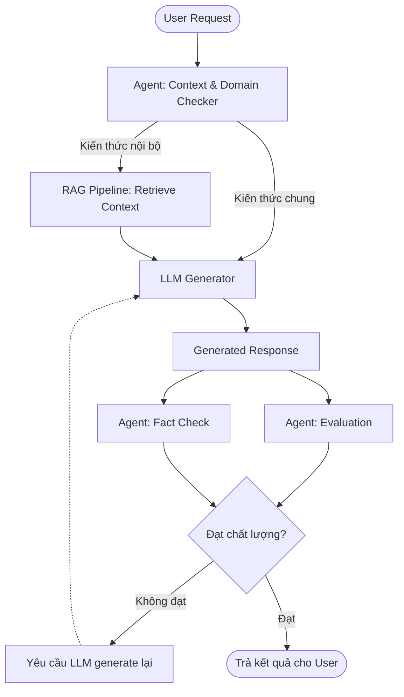
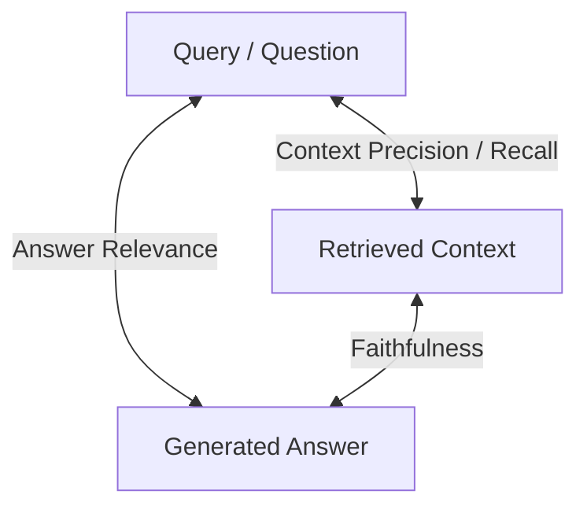
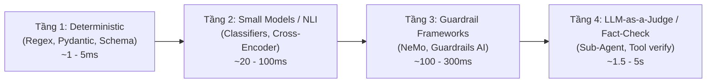
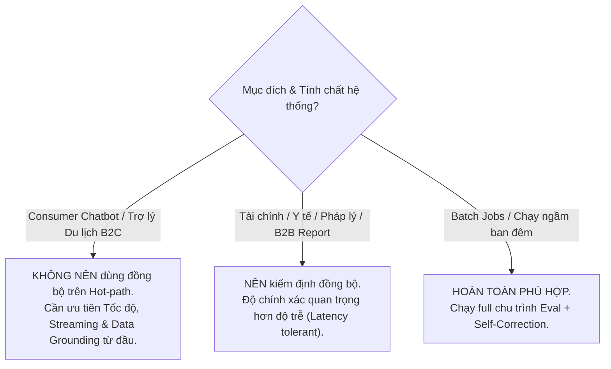
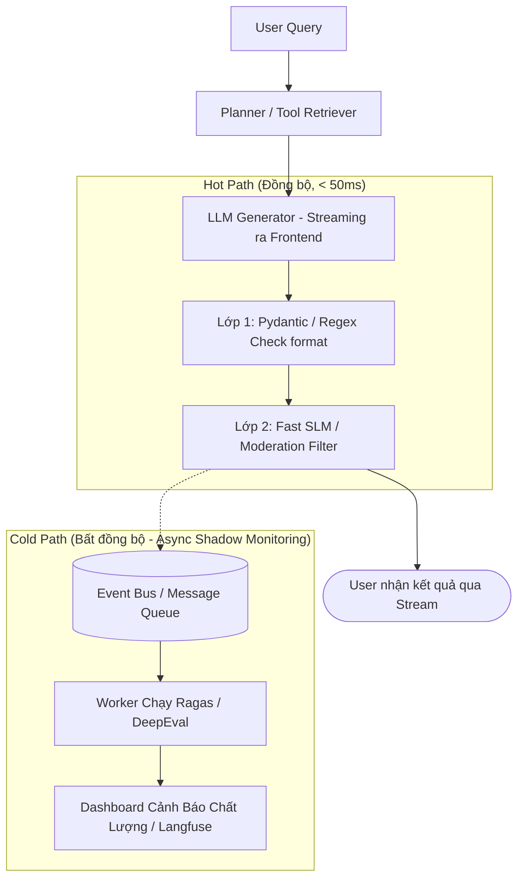

# 🛡️ Kiểm Soát LLM, Chống Ảo Giác & Cơ Chế Đánh Giá (Evaluation) Tại Runtime

Tài liệu tổng hợp và phân tích kiến trúc kiểm soát chất lượng phản hồi của LLM/Agent, vai trò của framework Ragas, các giải pháp Runtime Guardrails, và tính thực tế của vòng lặp Đánh giá – Tái sinh (Evaluation – Regeneration Loop).

---

## 📌 Bối Cảnh & Các Câu Hỏi Thảo Luận

### 1. Kịch Bản Nghiệp Vụ Của Hệ Thống
Hệ thống xử lý truy vấn du lịch (ví dụ: *"Lên kế hoạch du lịch Đà Lạt 3 ngày 2 đêm"*) theo luồng:
1. **Input Stage:** Query gửi tới backend agent, đi qua các agent kiểm tra context, intent và domain.
2. **Generation Stage:** Query được chuyển tới LLM để sinh câu trả lời.
3. **Post-generation Stage:** Có 2 agent (`evaluation` và `fact_check`) kiểm tra chất lượng output. Nếu không đạt, kích hoạt rework loop yêu cầu LLM generate lại.
4. **Sub-flow RAG:** Nếu câu hỏi thuộc về tri thức riêng của doanh nghiệp (chính sách, tour nội bộ, đối tác), hệ thống sẽ định tuyến qua pipeline RAG.

### 2. Các Câu Hỏi Đặt Ra
*   **Câu hỏi 1:** Ragas có chỉ áp dụng ở trường hợp hệ thống sử dụng RAG? Nếu luồng gọi thẳng LLM (không có context retrieval) thì Ragas có evaluate được không?
*   **Câu hỏi 2:** Hiện tại có những cơ chế nào để evaluate generation response của LLM ngay khi nó vừa chạy xong (Online / Runtime Evaluation)?
*   **Câu hỏi 3:** Việc đặt các agent evaluate + fact-check và yêu cầu generate lại ngay trong luồng phản hồi trực tiếp cho user thực tế có phù hợp và khả thi không?

---

## 🔍 Phần 1: Ragas Có Thể Đánh Giá Khi Không Dùng RAG?

### 1. Bản chất cốt lõi của Ragas
Ragas ban đầu được phát triển xung quanh **RAG Triad** (Bộ ba: *Query* – *Retrieved Context* – *Generated Answer*):

*   **Metric cốt lõi cần Context:** `Faithfulness` (Độ trung thực). Metric này đo lường xem từng nhận định trong `Answer` có được suy diễn logic từ `Context` hay không.
*   👉 **Nếu không có RAG (không có Context đưa vào):** Ragas **không thể tính `Faithfulness` theo định nghĩa nguyên bản**, vì không có nguồn tham chiếu để biết LLM có "bịa" so với nguồn hay không.

### 2. Ragas đánh giá được những gì khi gọi thẳng LLM (Non-RAG)?
Hiện tại Ragas đã phát triển mở rộng thành bộ công cụ đánh giá LLM tổng quát:

| Metric trong Ragas | Áp dụng Non-RAG? | Cơ chế đánh giá |
| :--- | :---: | :--- |
| **Answer Relevance** | ✅ **Có** | Đo độ liên quan ngữ nghĩa giữa `Query` và `Answer` bằng embedding/LLM. Không cần context. |
| **Aspect Critique** | ✅ **Có** | Đánh giá định tính thông qua prompt LLM-as-a-judge: độ độc hại (Harmfulness), độ súc tích (Conciseness), độ mạch lạc (Coherence). |
| **Custom Rubrics** | ✅ **Có** | Tự định nghĩa tiêu chí nghiệp vụ (ví dụ: "Lịch trình có đủ 3 ngày không? Có đề xuất khách sạn hợp lý không?"). |
| **Semantic Similarity** | ✅ **Có** | So sánh output với `Ground Truth` (nếu có tập dữ liệu mẫu). |
| **Agent / Tool Metrics** | ✅ **Có** | Đánh giá độ chính xác khi gọi Tool (Tool Call Accuracy), hoàn thành mục tiêu (Goal Accuracy). |
| **Faithfulness** | ❌ **Không** | Bắt buộc phải có `Context` làm căn cứ đối chiếu sự thật. |

> [!NOTE]
> Ragas hoàn toàn evaluate được luồng non-RAG về mặt hình thức, độ liên quan và tiêu chí logic, nhưng **không thể xác thực tính chính xác thực tế (Factuality)** của kiến thức bên ngoài nếu bạn không cung cấp dữ liệu đối chiếu.

---

## ⚡ Phần 2: Các Cơ Chế Evaluate Response Tại Runtime (Ngay Khi Vừa Chạy Xong)

Khi cần đánh giá response ngay trong luồng xử lý trước khi trả về cho user, ngành công nghiệp phân chia thành 4 cấp độ kỹ thuật:

### 1. Deterministic & Constrained Decoding (Tầng 1 — Siêu nhanh)
*   **Công cụ:** Pydantic, Instructor, Outlines, Jsonformer.
*   **Cách thức:** Ép LLM sinh output theo cấu trúc JSON định sẵn (Structured Output).
*   **Ưu điểm:** Độ trễ gần như bằng 0 (< 5ms). Bắt lỗi thiếu trường, sai định dạng ngay khi parse code mà không cần gọi thêm model.

### 2. Fast Small Language Models & Cross-Encoders (Tầng 2 — Rất nhanh)
*   **Công cụ:** DeBERTa NLI, RoBERTa toxicity classifier, Meta Llama Guard, Prompt Guard.
*   **Cách thức:**
    *   **NLI (Natural Language Inference):** Kiểm tra mâu thuẫn (Contradiction) giữa tiền đề và kết luận.
    *   **Toxicity / Safety Check:** Phát hiện ngôn từ không phù hợp trong 20–50ms.
*   **Ưu điểm:** Chạy local qua GPU/ONNX runtime, tốc độ cực nhanh, chi phí thấp.

### 3. Dedicated Guardrails Frameworks (Tầng 3)
*   **NeMo Guardrails (NVIDIA):**
    *   Định nghĩa các đường ray (rails) cho Input, Output và Flow đối thoại.
    *   Kiểm tra: Output có đi chệch chủ đề (off-topic), vi phạm policy, hoặc lộ dữ liệu nhạy cảm không.
*   **Guardrails AI (`guardrails` package):**
    *   Cung cấp hàng trăm validator dựng sẵn: `toxic_language`, `provenance_v1`, `regex_match`, `sql_column_presence`.
    *   Hỗ trợ tự động kích hoạt cơ chế `re-ask` (yêu cầu LLM format/sửa lại).

### 4. LLM-as-a-Judge & Fact-Checking Sub-Agents (Tầng 4 — Toàn diện nhưng nặng)
*   **Reflexion / Self-Refine Pattern:** Một agent hoặc một prompt thứ hai nhận câu trả lời, đối chiếu với tiêu chí nghiệp vụ và chấm điểm.
*   **Claim Extraction + Search Tool:**
    1. Trích xuất các khẳng định cụ thể (e.g., *"Khách sạn Colline nằm tại số 10 Phan Bội Châu, Đà Lạt"*).
    2. Gọi Google Search API / Maps API / Database nội bộ để verify từng claim.
    3. Nếu claim sai sự thật → Báo cờ vi phạm.

---

## ⚖️ Phần 3: Đánh Giá Tính Thực Tế — Có Nên Eval + Regenerate Ngay Trong Luồng User?

Áp dụng mô hình `LLM Generation → 2 Sub-Agents (Eval + Fact-check) → Rework Loop` trực tiếp trên hot-path phục vụ người dùng có phù hợp không?

### 1. Phân Tích Các Rào Cản Lớn

#### A. Độ Trễ (Latency) Giết Chết Trải Nghiệm (UX Killer)
| Công đoạn trong luồng | Thời gian ước tính (P50 - P90) |
| :--- | :--- |
| Routing / Context Checker | 0.8s – 1.5s |
| LLM Generator (Lịch trình 3N2Đ ~ 500-800 tokens) | 3.0s – 6.0s |
| Evaluation Agent (LLM-as-a-judge) | 1.5s – 2.5s |
| Fact-check Agent (Trích xuất claim + gọi API/Search) | 2.5s – 5.0s |
| **Tổng thời gian lần chạy đầu tiên** | **7.8s – 15.0s** |
| *Nếu Fail → Kích hoạt Rework Loop (Sinh lại)* | **+ 4.0s – 7.0s** |
| **Tổng thời gian user phải chờ** | **Có thể vượt quá 15 – 22 giây!** |

> [!WARNING]
> Khi đặt evaluator chặn trước phản hồi, bạn **không thể sử dụng tính năng Streaming (gõ từng chữ)**. User phải nhìn màn hình loading 10-15 giây, dẫn đến tỷ lệ drop-off (rời bỏ) cực cao.

#### B. Hiện Tượng "Vòng Lặp Ảo Giác" (Hallucination Loop)
*   Nếu LLM bịa ra một địa điểm vì parametric memory của nó **không có thông tin đó**, việc prompt lại: *"Câu trả lời của bạn sai, hãy tạo lại"* mà không cấp thêm kiến thức mới sẽ dẫn đến:
    *   Tiếp tục bịa ra một địa điểm sai khác.
    *   Hoặc phản hồi thụ động, thoái thác (*"Xin lỗi, tôi không thể lập kế hoạch..."*).
*   Chỉ regenerate mù quáng không giải quyết được gốc rễ của hallucination.

#### C. Chi Phí Token (Cost Overhead)
*   Mỗi lượt query của người dùng tốn ít nhất 3–4 lần gọi LLM.
*   Nếu có rework loop, con số tăng lên 6–8 lần. Chi phí vận hành tăng vọt 300% – 500%.

### 2. Khi Nào Nên Và Khi Nào Không Nên Áp Dụng?

---

## 🏆 Phần 4: Kiến Trúc Thực Tế Tối Ưu (Industry Best Practices)

Để vừa kiểm soát ảo giác, vừa giữ được tốc độ phản hồi cao cho ứng dụng du lịch, mô hình tối ưu hiện nay được thiết kế như sau:

### 1. Nguyên Tắc "Shift-Left" (Phòng Ngừa Thay Vì Chữa Cháy)
Thay vì để LLM tự do bịa rồi cử agent đi bắt lỗi, hãy cung cấp **dữ liệu chuẩn xác ngay từ đầu vào**:
*   Router Agent nhận diện intent: *"Cần lịch trình Đà Lạt 3N2Đ"*.
*   Hệ thống gọi API/Database lấy sẵn danh sách: 10 địa điểm nổi bật, 5 quán ăn được đánh giá cao, 3 khách sạn còn phòng.
*   Prompt đưa danh sách này vào context và chỉ thị rõ: *"Chỉ được sử dụng các địa điểm trong danh sách được cung cấp. Không tự ý thêm địa điểm ngoài"*.
*   **Kết quả:** Ảo giác giảm 85–90% mà không tốn thêm bất kỳ agent kiểm tra nào phía sau.

### 2. Mô Hình Đánh Giá Phân Tầng (Tiered Hot-Path)

### 3. Chiến Lược Phân Tách Online vs Offline Evaluation
*   **Online Guardrails (Nhẹ, tối giản trên Hot Path):**
    *   Chỉ kiểm tra những thứ gây rủi ro chết người (safety, jailbreak, format lỗi).
    *   Sử dụng regex hoặc SLM chuyên biệt.
*   **Offline / Async Evaluation (Nơi Ragas & DeepEval phát huy sức mạnh tối đa):**
    *   Ghi log toàn bộ cuộc hội thoại vào OpenTelemetry / Langfuse.
    *   Background worker lấy ngẫu nhiên 5% – 10% traffic thực tế để chạy Ragas đánh giá định kỳ.
    *   Chạy Ragas trên **Golden Dataset** (tập dữ liệu chuẩn) trong pipeline CI/CD trước khi deploy bất kỳ thay đổi nào về prompt hoặc model.

### 4. Nếu Bắt Buộc Phải Dùng Rework Loop (Guided Feedback)
Nếu câu hỏi thuộc phạm trù đặc thù bắt buộc phải qua Fact-check trước khi trả lời:
1.  **Khống chế số lần thử:** Cố định `max_retries = 1`.
2.  **Guided Feedback (Cung cấp giải pháp, không mắng chung chung):**
    *   ❌ *Không làm:* "Câu trả lời sai rồi, làm lại đi!"
    *   ✅ *Làm:* "Khách sạn X ở Đà Lạt hiện đã ngừng hoạt động. Hãy thay thế bằng Khách sạn Y (Địa chỉ: Z) từ cơ sở dữ liệu sau: [...]"
3.  **Fallback An Toàn:** Nếu lần retry thứ 2 vẫn không qua được bài kiểm tra, trả về câu trả lời an toàn đã được soạn sẵn (Fallback Template) thay vì để hệ thống treo hoặc trả về nội dung sai lệch.

---

## 📋 Bảng So Sánh Tổng Kết Các Công Cụ

| Công cụ | Vị trí phù hợp nhất | Độ trễ (Latency) | Điểm mạnh chính |
| :--- | :--- | :--- | :--- |
| **Ragas** | Offline (CI/CD, Batch Eval, Dataset Benchmark) | Cao (Vài giây/test) | Đánh giá toàn diện RAG Triad, đa dạng metric định tính |
| **DeepEval** | Offline CI/CD Unit Test cho LLM | Cao | Tích hợp sâu vào PyTest, quản lý test suite chuẩn xác |
| **NeMo Guardrails** | Online Hot-Path (Đồng bộ) | Trung bình (100-300ms) | Kiểm soát flow hội thoại, chặn lệch chủ đề (Colang) |
| **Guardrails AI** | Online Hot-Path (Đồng bộ) | Thấp - Trung bình | Đa dạng validator cấu trúc, JSON schema, auto-reask |
| **Small Models (NLI / Llama Guard)** | Online Hot-Path | Cực thấp (20-80ms) | Phân loại an toàn, mâu thuẫn sự thật nhanh gọn |
