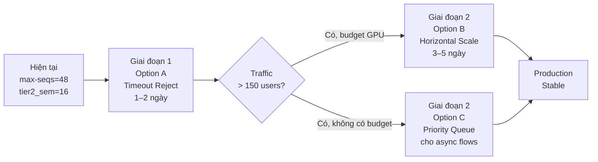

# Concurrency & Scaling Guide — Travel Agent vLLM Stack

> **Platform:** RTX 3090 (24 GB VRAM) · Co-located LLM + Embedding  
> **Stack:** Python asyncio → vLLM → Qwen2.5-7B-AWQ  
> **Mục tiêu tài liệu:** Giải thích cơ chế xử lý concurrent requests và các chiến lược scale

---

## 1. Kiến Trúc 4 Tầng Kiểm Soát Concurrency

Hệ thống có **4 tầng** kiểm soát luồng requests từ user đến GPU. Mỗi tầng là một bottleneck tiềm năng — chúng **phải được coordinate** với nhau, không được để một tầng nào thắt cổ chai vô hình.

```
┌─────────────────────────────────────────────────────────────────┐
│  TẦNG 0: Network / gRPC Server                                 │
│  Tiếp nhận kết nối TCP, tạo async coroutine cho mỗi request   │
│  Giới hạn: OS file descriptors, network bandwidth              │
├─────────────────────────────────────────────────────────────────┤
│  TẦNG 1: Graph Nodes (I/O bound — không gọi LLM)              │
│  Redis lookup, Qdrant search, semantic cache check             │
│  → Chạy SONG SONG tất cả requests (async I/O, không block)    │
├─────────────────────────────────────────────────────────────────┤
│  TẦNG 2: asyncio Semaphore (concurrency.py)                    │
│  TIER1_SEMAPHORE · TIER2_SEMAPHORE                             │
│  → Cổng kiểm soát: giới hạn concurrent LLM calls gửi đến vLLM │
│  → Requests vượt quota → SUSPEND (không block, không tốn CPU) │
├─────────────────────────────────────────────────────────────────┤
│  TẦNG 3: vLLM Server (max-num-seqs)                           │
│  → Nhận sequences, batch chúng vào GPU forward pass           │
│  → Requests vượt max-num-seqs → queue nội bộ của vLLM         │
└─────────────────────────────────────────────────────────────────┘
```

### Quy tắc bất biến

```
tier1_semaphore + tier2_semaphore  ≤  max-num-seqs  ≤  KV_cache_slots(VRAM)
```

Vi phạm quy tắc này sẽ dẫn đến một trong hai hệ quả:
- `semaphore > max-num-seqs` → App gửi nhiều hơn server xử lý được → latency tăng nghịch lý
- `max-num-seqs > KV_cache_slots` → vLLM OOM crash runtime

---

## 2. Điều Gì Xảy Ra Khi 1000 Requests Đổ Vào Cùng Lúc?

### Với config hiện tại (max-num-seqs=48, tier2_sem=16)

```
T=0s   1000 requests đến đồng thời
         │
         ├── 32 requests Tier-1 → qua semaphore → vLLM batch #1
         ├── 16 requests Tier-2 → qua semaphore → vLLM batch #1
         └── 952 requests SUSPEND tại semaphore
              (asyncio coroutines ngủ — không tốn thread, ~50MB RAM tổng cộng)

T=~2s  Batch #1 hoàn thành (input_guardrail ~2s)
         → 48 slots release → 48 requests tiếp theo vào
         → 904 vẫn đang chờ

T=~62s  Request thứ 1000 mới bắt đầu được xử lý input_guardrail
         [tính: 1000 / 32 × 2s ≈ 62s chỉ cho 1 node đầu tiên]

T=~150s Request thứ 1000 mới có response
         → User cuối chờ 2.5 phút
```

### So sánh: Thread Blocking vs asyncio Semaphore

| | Thread Blocking | asyncio Semaphore |
|---|---|---|
| 1000 requests chờ | 1000 threads × 8MB stack = **~8 GB RAM** | 1000 coroutines × ~50KB = **~50 MB RAM** |
| CPU khi chờ | Context switching liên tục, **wasted** | 0% — event loop làm việc khác |
| Crash khi quá tải | ✅ Có (thread exhaustion, OOM) | ❌ Không — chỉ **chậm** |
| Khả năng timeout | Phức tạp | Dễ với `asyncio.wait_for` |

> **Insight quan trọng:** asyncio semaphore **không làm crash** hệ thống khi overload — nó chỉ làm user chờ lâu hơn. Đây vừa là điểm mạnh (stability) vừa là điểm yếu (silent degradation, user không biết lý do chờ).

---

## 3. Tại Sao Semaphore Quá Nhỏ Lại Nguy Hiểm?

Điều phản trực giác: **semaphore nhỏ hơn không có nghĩa là an toàn hơn — nó làm hệ thống kém hiệu quả hơn.**

### GPU Utilization theo semaphore size

```
tier2_semaphore=4  →  vLLM nhận 4 sequences / batch
                   →  GPU forward pass: 4 sequences
                   →  GPU utilization: ~8%
                   →  Throughput: 4 / 30s = 0.13 req/s
                   →  1000 requests mất ~2 tiếng

tier2_semaphore=16 →  vLLM nhận 16 sequences / batch
                   →  GPU utilization: ~33%
                   →  Throughput: 16 / 30s = 0.53 req/s
                   →  1000 requests mất ~31 phút

tier2_semaphore=16 + max-num-seqs=48 + max-batched-tokens=2048
                   →  vLLM batching nhiều sequences cùng lúc
                   →  GPU utilization: ~80–90%
                   →  Throughput: tăng 3–4x so với tier2=4
```

**Nguyên lý:** GPU hiệu quả nhất khi được feed đủ work để tận dụng hàng nghìn CUDA cores song song. Semaphore nhỏ → GPU nhàn rỗi → throughput thấp → latency cao hơn, không phải thấp hơn.

---

## 4. Giới Hạn Thực Tế Theo Số Lượng Concurrent Users

| Concurrent Users | max-num-seqs | tier1_sem | tier2_sem | E2E p50 | GPU Util |
|---|---|---|---|---|---|
| ≤ 50 | 16 | 12 | 4 | ~5–10s | ~20% |
| ≤ 150 | 48 | 32 | 16 | ~10–20s | ~60% |
| ≤ 300 | 48 × 2 instance | 64 | 32 | ~15–25s | ~80% |
| ≤ 500 | 48 × 3 instance | 96 | 48 | ~20–30s | ~85% |
| 1000 | 48 × 4–5 instance | 160 | 64 | ~25–40s | ~90% |

> **Kết luận thực tế:** Với **1 RTX 3090 duy nhất**, giới hạn thực tế là ~**150 concurrent users** nếu muốn giữ E2E p50 < 30s. Trên 150 → phải chọn 1 trong 3 options dưới đây.

---

## 5. Ba Giải Pháp Xử Lý Overload

---

### Option A: Semaphore Có Timeout + Fast Reject

**Mô tả:** Giữ nguyên kiến trúc 1 server, nhưng thêm timeout vào semaphore. Requests chờ quá lâu sẽ nhận `503 Service Unavailable` ngay thay vì chờ vô hạn.

```python
# app/core/concurrency.py — thêm timeout wrapper

import asyncio
from fastapi import HTTPException

async def acquire_llm_slot(tier: int, timeout: float = 30.0):
    """
    Attempts to acquire an LLM semaphore slot within the given timeout.
    Raises HTTP 503 immediately if the system is overloaded.
    
    Args:
        tier: LLM tier (1=fast, 2=balanced)
        timeout: Max seconds to wait for a slot before rejecting (default 30s)
    """
    sem = get_semaphore(tier)
    try:
        await asyncio.wait_for(sem.acquire(), timeout=timeout)
    except asyncio.TimeoutError:
        raise HTTPException(
            status_code=503,
            detail={
                "error": "server_overloaded",
                "message": "System is at capacity. Please retry in 30 seconds.",
                "retry_after": 30,
            }
        )
```

**Tích hợp vào `invoke_llm_with_limit`:**
```python
# config.py — thay `async with sem:` bằng:
await acquire_llm_slot(tier, timeout=30.0)
try:
    response = await llm.ainvoke(messages, config, **invoke_kwargs)
finally:
    get_semaphore(tier).release()
```

**Client-side retry (gRPC):**
```python
# Thêm retry logic ở gRPC client khi nhận status UNAVAILABLE
import grpc
from tenacity import retry, wait_exponential, stop_after_attempt

@retry(wait=wait_exponential(min=5, max=60), stop=stop_after_attempt(3))
async def call_agent_with_retry(stub, request):
    try:
        return await stub.StreamChat(request)
    except grpc.RpcError as e:
        if e.code() == grpc.StatusCode.UNAVAILABLE:
            raise  # trigger retry
        raise
```

#### ✅ Điểm mạnh

| Điểm mạnh | Lý do |
|---|---|
| **Đơn giản nhất** | Chỉ sửa ~20 dòng code, không thêm infrastructure |
| **Fail-fast cho user** | User biết ngay hệ thống bận thay vì chờ 3 phút không rõ lý do |
| **Bảo vệ GPU** | Ngăn request storm làm vLLM OOM |
| **Observable** | Dễ monitor: đếm 503 responses trong Prometheus |
| **Zero dependency mới** | Không cần thêm service nào |

#### ❌ Điểm yếu

| Điểm yếu | Hệ quả |
|---|---|
| **Drop requests** | User nhận lỗi 503, phải tự retry — UX không tốt |
| **Không có queue** | Requests bị từ chối hoàn toàn, không có cơ chế "chờ đến khi available" |
| **Timeout tuning phức tạp** | Timeout quá ngắn → reject oan; quá dài → user chờ lâu |
| **Không ưu tiên được** | Mọi requests đều bình đẳng — không phân biệt premium user |

**Phù hợp với:** Dev/staging, early production với traffic không ổn định, khi cần giải pháp nhanh.

---

### Option B: Horizontal Scale vLLM + Load Balancer

**Mô tả:** Deploy nhiều vLLM instances song song, dùng nginx hoặc Envoy phân phối requests theo round-robin hoặc least-connection.

```
                        ┌──────────────────────────────────┐
1000 requests           │        Load Balancer             │
──────────────►         │  (nginx / Envoy / HAProxy)       │
                        │                                  │
                        │  Algorithm: least_conn           │
                        │  Health check: /health endpoint  │
                        └──────┬───────────┬──────────────-┘
                               │           │           │
                        ┌──────▼─┐  ┌──────▼─┐  ┌──────▼─┐
                        │vLLM #1 │  │vLLM #2 │  │vLLM #3 │
                        │RTX3090 │  │RTX3090 │  │RTX3090 │
                        │seqs=48 │  │seqs=48 │  │seqs=48 │
                        └────────┘  └────────┘  └────────┘
                        Tổng capacity: 144 concurrent sequences
```

**nginx config (ví dụ):**
```nginx
upstream vllm_cluster {
    least_conn;  # route đến server ít connection nhất
    server 10.0.0.1:18000 weight=1 max_fails=3 fail_timeout=30s;
    server 10.0.0.2:18000 weight=1 max_fails=3 fail_timeout=30s;
    server 10.0.0.3:18000 weight=1 max_fails=3 fail_timeout=30s;
    keepalive 32;
}

server {
    listen 20191;
    location /v1/ {
        proxy_pass http://vllm_cluster;
        proxy_connect_timeout 5s;
        proxy_read_timeout 120s;  # đủ cho ReAct loop dài
    }
}
```

**Cập nhật `concurrency.py` khi scale 3x:**
```python
_CONCURRENCY = {
    # 3 instances × 48 seqs = 144 total
    "vllm": {"tier1": 96, "tier2": 48},
}
```

#### ✅ Điểm mạnh

| Điểm mạnh | Lý do |
|---|---|
| **Throughput tuyến tính** | 2x instances = ~2x throughput (gần đúng) |
| **Fault tolerance** | 1 instance chết → load balancer redirect sang instance còn lại |
| **Không thay đổi code** | Chỉ cần update `VLLM_BASE_URL` trong `.env` trỏ đến LB |
| **Scale down được** | Ban đêm ít traffic → tắt bớt instance tiết kiệm chi phí Vast.ai |
| **GPU fully utilized** | Mỗi GPU chạy max-num-seqs=48 đầy đủ |

#### ❌ Điểm yếu

| Điểm yếu | Hệ quả |
|---|---|
| **Chi phí tuyến tính** | 3x instances = 3x tiền Vast.ai GPU |
| **Không giải quyết hot-path chậm** | Nếu 1 request mất 30s, 10 instances cũng không làm nó nhanh hơn |
| **Model weights load N lần** | Mỗi instance load ~7.5GB weights vào VRAM riêng |
| **Stateless yêu cầu** | vLLM stateless → OK; nhưng prefix caching không shared giữa instances |
| **Ops phức tạp hơn** | Phải monitor N instances, LB health check, rolling restart |

**Phù hợp với:** Production khi traffic thực sự cao và ổn định, khi có budget GPU, khi cần fault tolerance.

---

### Option C: Priority Queue với RabbitMQ (Có sẵn trong stack)

**Mô tả:** Thay vì reject hoặc scale ngang, dùng RabbitMQ (đã có trong stack) làm buffer queue phía trước LLM calls. Requests không bao giờ bị drop — chúng được xếp hàng có thứ tự ưu tiên và xử lý tuần tự khi GPU available.

```
1000 Requests
     │
     ▼
┌─────────────────────────────────────────────────────┐
│  gRPC Handler — nhận request, trả lời ngay:        │
│  "Request queued. Estimated wait: ~45s"             │
│  → Publish message vào RabbitMQ queue               │
│  → Return job_id cho client                         │
└──────────────────────┬──────────────────────────────┘
                       │ 1000 messages → RabbitMQ
                       ▼
┌─────────────────────────────────────────────────────┐
│  RabbitMQ Priority Queue                           │
│  Priority 3 (HIGH):   Premium users, retry         │
│  Priority 2 (NORMAL): Standard requests            │
│  Priority 1 (LOW):    Background/batch             │
│                                                     │
│  → Persist messages (durable=True)                 │
│  → Survive server restart                           │
└──────────────────────┬──────────────────────────────┘
                       │ Consumer pull theo semaphore
                       ▼
┌─────────────────────────────────────────────────────┐
│  LLM Worker Consumer (N workers)                   │
│  → Pull 48 messages/batch (= max-num-seqs)         │
│  → Gửi đến vLLM                                    │
│  → Kết quả → Redis (session_id key)                │
│  → Notify client qua WebSocket / SSE               │
└─────────────────────────────────────────────────────┘
```

**Triển khai cơ bản:**
```python
# app/services/background_tasks/llm_queue_publisher.py

import aio_pika, json

LLM_REQUEST_QUEUE = "llm.requests"

async def enqueue_llm_request(
    session_id: str,
    messages: list,
    tier: int,
    priority: int = 2,  # 1=low, 2=normal, 3=high
) -> str:
    """
    Enqueue an LLM request instead of calling vLLM directly.
    Returns job_id. Client polls or subscribes for result.
    """
    job_id = f"{session_id}_{uuid4().hex[:8]}"
    payload = {
        "job_id": job_id,
        "session_id": session_id,
        "messages": messages,
        "tier": tier,
        "enqueued_at": time.time(),
    }
    connection = await get_connection()
    channel = await connection.channel()
    queue = await channel.declare_queue(
        LLM_REQUEST_QUEUE,
        durable=True,
        arguments={"x-max-priority": 3}  # RabbitMQ priority queue
    )
    await channel.default_exchange.publish(
        aio_pika.Message(
            body=json.dumps(payload).encode(),
            delivery_mode=aio_pika.DeliveryMode.PERSISTENT,
            priority=priority,
        ),
        routing_key=LLM_REQUEST_QUEUE,
    )
    return job_id


# app/services/background_tasks/llm_worker.py

async def run_llm_worker():
    """Consumer: pulls from queue, calls vLLM, stores result in Redis."""
    connection = await aio_pika.connect_robust(settings.rabbitmq.url)
    channel = await connection.channel()
    await channel.set_qos(prefetch_count=16)  # = tier2_semaphore
    queue = await channel.declare_queue(LLM_REQUEST_QUEUE, durable=True)
    
    async with queue.iterator() as q:
        async for message in q:
            async with message.process():
                payload = json.loads(message.body)
                result = await call_vllm(payload["messages"], payload["tier"])
                # Store result in Redis for client polling
                await redis.setex(
                    f"llm_result:{payload['job_id']}",
                    ttl=300,
                    value=json.dumps(result)
                )
```

#### ✅ Điểm mạnh

| Điểm mạnh | Lý do |
|---|---|
| **Zero request drop** | Mọi request đều được xử lý, không bao giờ bị 503 |
| **Priority scheduling** | Premium users / urgent requests lên đầu queue |
| **Back-pressure tự nhiên** | Queue fill → producer biết cần scale |
| **Durable queue** | Restart server không mất request đang chờ |
| **RabbitMQ đã có sẵn** | Không cần thêm infrastructure mới |
| **Observable** | Queue depth metric → alert khi backlog > threshold |

#### ❌ Điểm yếu

| Điểm yếu | Hệ quả |
|---|---|
| **Thay đổi UX hoàn toàn** | Từ sync request → async job: client cần poll hoặc WebSocket |
| **Phức tạp nhất** | Phải implement: job_id, result storage, client notification, TTL cleanup |
| **Latency không thể đoán** | "Request của bạn sẽ xong sau 45s" — user có thể không chấp nhận |
| **Client phải thay đổi** | gRPC client cần hỗ trợ async polling / streaming |
| **Stale result risk** | Nếu client disconnect, result nằm trong Redis vô ích |

**Phù hợp với:** Background jobs (fact extraction, shadow eval đã dùng pattern này), batch processing, use-case mà user chấp nhận async (email notification, report generation).

---

## 6. So Sánh Tổng Hợp 3 Options

| Tiêu chí | Option A: Timeout Reject | Option B: Horizontal Scale | Option C: Priority Queue |
|---|---|---|---|
| **Độ phức tạp implement** | 🟢 Thấp (1–2 ngày) | 🟡 Trung bình (3–5 ngày) | 🔴 Cao (1–2 tuần) |
| **Chi phí infrastructure** | 🟢 Không thêm | 🔴 N× GPU cost | 🟢 Không thêm |
| **Request drop** | 🔴 Có (503) | 🟢 Không | 🟢 Không |
| **Latency khi cao tải** | 🟡 Giảm (reject fast) | 🟢 Tốt nhất | 🟡 Cao (queue wait) |
| **Fault tolerance** | 🔴 Single point | 🟢 Multi instance | 🟡 Queue là SPOF |
| **Thay đổi UX** | 🟢 Minimal | 🟢 Transparent | 🔴 Toàn bộ flow |
| **Phù hợp traffic** | Burst ngắn | Sustained high | Async acceptable |
| **Áp dụng ngay được** | ✅ | ✅ (nếu có GPU) | 🔄 Cần refactor |

---

## 7. Khuyến Nghị Lộ Trình



### Giai đoạn 1 — Làm ngay (Option A)

Implement timeout semaphore để bảo vệ hệ thống khỏi request storm. Chi phí thấp, hiệu quả ngay.

### Giai đoạn 2 — Khi traffic tăng

- **Có thêm GPU budget** → Option B: Horizontal Scale là lựa chọn tốt nhất về UX và throughput.
- **Không có thêm GPU** → Option C: Priority Queue cho các flows chấp nhận async (shadow eval, fact extraction đã có pattern này rồi).
- **Lý tưởng nhất** → Kết hợp A + B: Scale ngang + reject fast khi tất cả instances đều full.

---

## 8. Monitoring — Dấu Hiệu Cần Scale

Theo dõi các metrics này trong Grafana để biết khi nào cần action:

| Metric | Ngưỡng cảnh báo | Ngưỡng nguy hiểm | Action |
|---|---|---|---|
| `E2E p95 latency` | > 30s | > 60s | Scale Option B |
| `semaphore_wait_time` | > 10s | > 25s | Tăng semaphore hoặc scale |
| `HTTP 503 rate` | > 5% requests | > 20% | Scale immediately |
| `vLLM queue depth` | > 20 | > max-num-seqs | Scale hoặc throttle upstream |
| `GPU utilization` | < 50% | — | Semaphore đang quá conservative |
| `GPU utilization` | > 95% | — | Cần scale horizontal |

```bash
# Query Prometheus để monitor semaphore saturation
# (cần expose custom metric từ concurrency.py)

# Request wait time histogram
histogram_quantile(0.95, llm_semaphore_wait_seconds_bucket{tier="2"})

# 503 rate
rate(http_responses_total{status="503"}[5m]) / rate(http_responses_total[5m])
```
