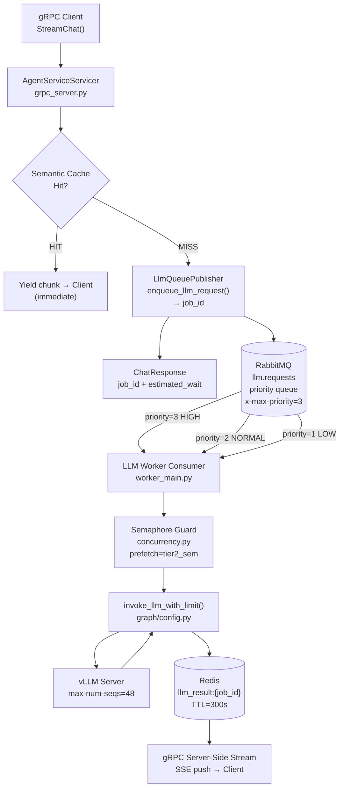
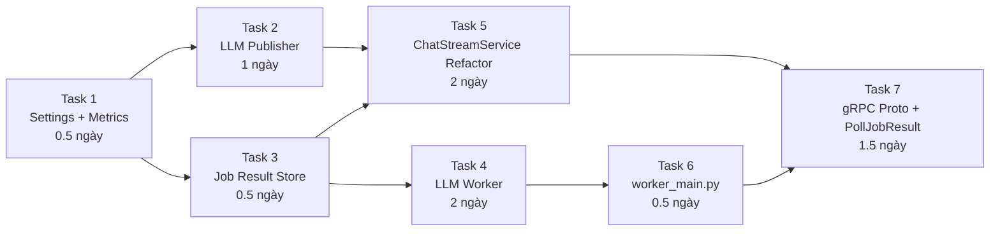

# Implementation Plan — Option C: Priority Queue với RabbitMQ

> **Branch:** `feat/async-queue-rabbitmq`

> **Base:** `origin/sprint-a/fast-safe-hotpath`

> **Thời gian ước tính:** 7–10 ngày làm việc

> **Mục tiêu:** Tích hợp RabbitMQ Priority Queue vào hot-path LLM calls, giữ nguyên Semaphore như một lớp bảo vệ nội bộ trong worker.

> **Tài liệu gốc:** [concurrency_scaling_guide.md](concurrency_scaling_guide.md)
---

## Tổng Quan Kiến Trúc Sau Khi Implement



> [!IMPORTANT]
> Kiến trúc này **không xoá Semaphore**. Semaphore vẫn hoạt động bên trong LLM Worker Consumer để giới hạn số concurrent calls đến vLLM. Tầng mới (RabbitMQ) thay thế vai trò "queue requests tại hot-path", không phải thay thế bảo vệ GPU.

---

## Phân Tích Codebase Hiện Tại

### Những gì đã có sẵn ✅

| Thành phần | File | Trạng thái |
|---|---|---|
| RabbitMQ connection pool (robust) | [`rabbitmq_publisher.py`](../../../../agent/app/services/background_tasks/rabbitmq_publisher.py) | ✅ Có `get_connection()` với retry logic |
| DLQ pattern | [`rabbitmq_publisher.py`](../../../../agent/app/services/background_tasks/rabbitmq_publisher.py) | ✅ DLX + DLQ cho `fact_extraction` và `eval.shadow` |
| Worker consumer pattern | [`worker_main.py`](../../../../agent/app/worker_main.py) | ✅ 3 consumer đang chạy: fact_extraction, hotel_sync, shadow_eval |
| Semaphore concurrency guard | [`concurrency.py`](../../../../agent/app/core/concurrency.py) | ✅ `TIER1_SEMAPHORE`, `TIER2_SEMAPHORE`, `get_semaphore()` |
| `invoke_llm_with_limit()` | [`graph/config.py`](../../../../agent/app/graph/config.py#L214-L274) | ✅ Semaphore + retry + metrics đầy đủ |
| Prometheus metrics | [`metrics.py`](../../../../agent/app/core/metrics.py) | ✅ Sẵn sàng thêm queue metrics |
| `RabbitMQSettings` | [`settings.py`](../../../../agent/app/core/settings.py#L108-L111) | ✅ `url`, `queue_name` đã có |
| `ChatStreamService.stream()` | [`chat_stream_service.py`](../../../../../agent/app/services/streaming/chat_stream_service.py#L120-L343) | ✅ Entry point cần refactor sang async |

### Những gì cần tạo mới ❌

| Thành phần | File mới | Mô tả |
|---|---|---|
| LLM Request Publisher | `services/background_tasks/llm_queue_publisher.py` | Enqueue LLM job vào priority queue |
| LLM Worker Consumer | `services/background_tasks/llm_worker.py` | Pull và xử lý job, lưu result vào Redis |
| Job Result Store | `services/job_result_store.py` | Thin wrapper Redis get/set/wait cho job_id |
| Queue Metrics | Thêm vào `metrics.py` | `llm_queue_depth`, `llm_queue_wait_seconds` |
| Settings mở rộng | Thêm vào `settings.py` | `llm_requests_queue`, `llm_result_ttl` |
| gRPC poll/stream endpoint | Thêm vào `grpc_layer/chat.proto` | `PollJobResult(job_id)` hoặc `StreamJobResult()` |

---

## Chi Tiết Tasks (7 Tasks, 7–10 ngày)

---

### Task 1 — Mở rộng Settings & Queue Metrics
**Thời gian:** 0.5 ngày | **File:** `settings.py`, `metrics.py`

**1a. Thêm constants vào `RabbitMQSettings`:**
```python
# settings.py — class RabbitMQSettings
llm_requests_queue: str = "llm.requests"      # Queue mới cho LLM jobs
llm_requests_dlq:   str = "llm_requests_dlq"  # Dead Letter Queue
llm_requests_dlx:   str = "dlx_llm_exchange"  # Dead Letter Exchange
llm_result_ttl:     int = 300                  # Giây TTL của result trong Redis
llm_max_priority:   int = 3                    # 1=low, 2=normal, 3=high
```

**1b. Thêm Prometheus metrics vào `metrics.py`:**
```python
# metrics.py — Section 8 mới: LLM Queue Metrics
LLM_QUEUE_DEPTH = Gauge(
    "llm_queue_depth",
    "Current number of pending LLM jobs in RabbitMQ priority queue",
)

LLM_QUEUE_WAIT_SECONDS = Histogram(
    "llm_queue_wait_seconds",
    "Time a job waited in RabbitMQ queue before being consumed by worker",
    ["priority"],  # "1" | "2" | "3"
    buckets=(0.1, 0.5, 1.0, 2.5, 5.0, 10.0, 20.0, 40.0, 60.0, 120.0),
)

LLM_JOB_PROCESSED_TOTAL = Counter(
    "llm_job_processed_total",
    "Total LLM jobs processed by worker",
    ["status"],  # "ok" | "error" | "timeout"
)
```

---

### Task 2 — LLM Queue Publisher
**Thời gian:** 1 ngày | **File mới:** `services/background_tasks/llm_queue_publisher.py`

Tái sử dụng `get_connection()` từ `rabbitmq_publisher.py` (tránh duplicate connection logic).

```python
# app/services/background_tasks/llm_queue_publisher.py

import json
import time
from uuid import uuid4
import aio_pika
from app.core.settings import settings
from app.core.logger import setup_app_logger
from app.services.background_tasks.rabbitmq_publisher import get_connection  # Reuse!

logger = setup_app_logger("LlmQueuePublisher")

LLM_REQUESTS_QUEUE = settings.rabbitmq.llm_requests_queue


async def enqueue_llm_request(
    session_id: str,
    user_id: str,
    messages: list,
    tier: int,
    priority: int = 2,  # 1=low, 2=normal, 3=high
    extra_state: dict = None,
) -> str:
    """
    Enqueue a full LLM graph job into the priority queue.
    Returns job_id. Caller is responsible for polling/subscribing to result.
    
    Priority levels:
        3 (HIGH)   — Premium users, retried jobs
        2 (NORMAL) — Standard authenticated requests  
        1 (LOW)    — Anonymous users, background batch
    """
    job_id = f"{session_id}_{uuid4().hex[:8]}"
    payload = {
        "job_id":      job_id,
        "session_id":  session_id,
        "user_id":     user_id,
        "messages":    messages,
        "tier":        tier,
        "priority":    priority,
        "enqueued_at": time.time(),
        "extra_state": extra_state or {},
    }

    connection = await get_connection()
    channel = await connection.channel()
    try:
        # Declare DLX + DLQ cho LLM queue (idempotent)
        dlx = await channel.declare_exchange(
            settings.rabbitmq.llm_requests_dlx,
            aio_pika.ExchangeType.DIRECT
        )
        dlq = await channel.declare_queue(settings.rabbitmq.llm_requests_dlq, durable=True)
        await dlq.bind(dlx, routing_key=settings.rabbitmq.llm_requests_dlq)

        await channel.declare_queue(
            LLM_REQUESTS_QUEUE,
            durable=True,
            arguments={
                "x-max-priority":         settings.rabbitmq.llm_max_priority,
                "x-dead-letter-exchange":  settings.rabbitmq.llm_requests_dlx,
                "x-dead-letter-routing-key": settings.rabbitmq.llm_requests_dlq,
            },
        )

        await channel.default_exchange.publish(
            aio_pika.Message(
                body=json.dumps(payload, ensure_ascii=False).encode(),
                delivery_mode=aio_pika.DeliveryMode.PERSISTENT,
                priority=priority,
            ),
            routing_key=LLM_REQUESTS_QUEUE,
        )
        logger.info(f"[LlmQueue] Enqueued job={job_id} session={session_id} priority={priority}")
        return job_id
    finally:
        await channel.close()
```

> [!NOTE]
> Hàm `get_connection()` được **import từ `rabbitmq_publisher.py`** để tái dùng connection pool singleton, tránh tạo thêm connection mới cho cùng một process.

---

### Task 3 — Job Result Store (Redis Layer)
**Thời gian:** 0.5 ngày | **File mới:** `services/job_result_store.py`

```python
# app/services/job_result_store.py
"""
Thin async wrapper around Redis for storing and retrieving LLM job results.
Worker writes → gRPC server reads.
"""
import json
import asyncio
from app.core.settings import settings
from app.core.logger import setup_app_logger
from redis.asyncio import Redis

logger = setup_app_logger("JobResultStore")

_RESULT_PREFIX = "llm_result:"
_STATUS_PREFIX  = "llm_status:"  # "queued" | "processing" | "done" | "error"


async def set_job_result(redis: Redis, job_id: str, result: dict, ttl: int = None) -> None:
    ttl = ttl or settings.rabbitmq.llm_result_ttl
    await redis.setex(f"{_RESULT_PREFIX}{job_id}", ttl, json.dumps(result, ensure_ascii=False))
    await redis.setex(f"{_STATUS_PREFIX}{job_id}", ttl, "done")


async def set_job_status(redis: Redis, job_id: str, status: str, ttl: int = None) -> None:
    ttl = ttl or settings.rabbitmq.llm_result_ttl
    await redis.setex(f"{_STATUS_PREFIX}{job_id}", ttl, status)


async def get_job_result(redis: Redis, job_id: str) -> dict | None:
    raw = await redis.get(f"{_RESULT_PREFIX}{job_id}")
    return json.loads(raw) if raw else None


async def get_job_status(redis: Redis, job_id: str) -> str | None:
    raw = await redis.get(f"{_STATUS_PREFIX}{job_id}")
    return raw.decode() if raw else None


async def wait_for_job(
    redis: Redis,
    job_id: str,
    timeout: float = 120.0,
    poll_interval: float = 0.5,
) -> dict | None:
    """
    Polls Redis for job result until available or timeout.
    Used by gRPC handler for streaming response back to client.
    """
    deadline = asyncio.get_event_loop().time() + timeout
    while asyncio.get_event_loop().time() < deadline:
        result = await get_job_result(redis, job_id)
        if result is not None:
            return result
        await asyncio.sleep(poll_interval)
    return None  # Timeout
```

---

### Task 4 — LLM Worker Consumer
**Thời gian:** 2 ngày | **File mới:** `services/background_tasks/llm_worker.py`

Đây là core consumer. Kế thừa đúng pattern từ `shadow_eval_worker.py` (prefetch, DLQ binding, `message.process()` context manager).

```python
# app/services/background_tasks/llm_worker.py
"""
LLM Worker Consumer — Consumer for the llm.requests RabbitMQ priority queue.

Design principles:
- prefetch_count = tier2_semaphore: Worker pulls exactly as many jobs as 
  vLLM can concurrently handle. This is the natural back-pressure mechanism.
- Semaphore guard is kept INSIDE the worker (not removed) to protect vLLM
  from worker restarts where multiple instances might be running temporarily.
- Each job result is stored in Redis with TTL for gRPC server to stream back.
"""
import asyncio
import json
import time
import aio_pika
from app.core.settings import settings
from app.core.logger import setup_app_logger
from app.core.concurrency import get_semaphore
from app.graph.config import invoke_llm_with_limit, get_llm_instance
from app.services.job_result_store import set_job_result, set_job_status
from app.core.metrics import LLM_QUEUE_WAIT_SECONDS, LLM_JOB_PROCESSED_TOTAL
from redis.asyncio import Redis

logger = setup_app_logger("LlmWorker")
LLM_REQUESTS_QUEUE = settings.rabbitmq.llm_requests_queue


async def process_llm_job(payload: dict, redis: Redis) -> None:
    """
    Core processing logic for a single LLM job from the queue.
    Calls invoke_llm_with_limit() (which manages semaphore internally).
    """
    job_id    = payload["job_id"]
    session_id = payload["session_id"]
    tier      = payload.get("tier", 2)
    messages  = payload["messages"]
    priority  = payload.get("priority", 2)
    enqueued_at = payload.get("enqueued_at", time.time())

    # Measure queue wait time for Prometheus
    queue_wait = time.time() - enqueued_at
    LLM_QUEUE_WAIT_SECONDS.labels(priority=str(priority)).observe(queue_wait)

    await set_job_status(redis, job_id, "processing")
    logger.info(f"[LlmWorker] Processing job={job_id} tier={tier} queue_wait={queue_wait:.2f}s")

    try:
        llm = get_llm_instance(tier)
        response, token_usage = await invoke_llm_with_limit(
            tier=tier,
            llm=llm,
            messages=messages,
            node_name="llm_worker",
        )
        result = {
            "job_id":      job_id,
            "session_id":  session_id,
            "content":     response.content,
            "status":      "done",
            "input_tokens":  token_usage.input_tokens,
            "output_tokens": token_usage.output_tokens,
            "completed_at":  time.time(),
        }
        await set_job_result(redis, job_id, result)
        LLM_JOB_PROCESSED_TOTAL.labels(status="ok").inc()
        logger.info(f"[LlmWorker] Done job={job_id} tokens={token_usage.output_tokens}")

    except Exception as e:
        LLM_JOB_PROCESSED_TOTAL.labels(status="error").inc()
        logger.error(f"[LlmWorker] Failed job={job_id}: {e}")
        await set_job_result(redis, job_id, {
            "job_id":    job_id,
            "status":    "error",
            "error":     str(e),
            "completed_at": time.time(),
        })


async def run_llm_worker(redis: Redis) -> None:
    """
    Main consumer loop for the llm.requests priority queue.
    prefetch_count matches tier2_semaphore to prevent pulling more than vLLM can handle.
    """
    logger.info("[LlmWorker] Starting consumer on queue %s...", LLM_REQUESTS_QUEUE)

    max_retries = 5
    for attempt in range(max_retries):
        try:
            connection = await aio_pika.connect_robust(settings.rabbitmq.url)
            break
        except Exception as e:
            if attempt == max_retries - 1:
                logger.error("[LlmWorker] Failed to connect after %d attempts: %s", max_retries, e)
                raise
            logger.warning("[LlmWorker] RabbitMQ not ready (attempt %d/%d), retrying in 5s...", attempt + 1, max_retries)
            await asyncio.sleep(5)

    channel = await connection.channel()
    # prefetch = tier2_semaphore value: worker won't pull more than vLLM can handle
    from app.core.concurrency import _CONCURRENCY
    _cfg = _CONCURRENCY.get(settings.llm_provider, {"tier1": 4, "tier2": 2})
    await channel.set_qos(prefetch_count=_cfg["tier2"])

    # Redeclare queue (idempotent) with same parameters as publisher
    dlx = await channel.declare_exchange(
        settings.rabbitmq.llm_requests_dlx, aio_pika.ExchangeType.DIRECT
    )
    dlq = await channel.declare_queue(settings.rabbitmq.llm_requests_dlq, durable=True)
    await dlq.bind(dlx, routing_key=settings.rabbitmq.llm_requests_dlq)

    queue = await channel.declare_queue(
        LLM_REQUESTS_QUEUE,
        durable=True,
        arguments={
            "x-max-priority":            settings.rabbitmq.llm_max_priority,
            "x-dead-letter-exchange":    settings.rabbitmq.llm_requests_dlx,
            "x-dead-letter-routing-key": settings.rabbitmq.llm_requests_dlq,
        },
    )

    async def _on_message(message: aio_pika.IncomingMessage) -> None:
        async with message.process():
            try:
                payload = json.loads(message.body.decode())
                await process_llm_job(payload, redis)
            except Exception as e:
                logger.error("[LlmWorker] Message processing error: %s", e)

    await queue.consume(_on_message)
    logger.info("[LlmWorker] Consumer active on %s (prefetch=%d).", LLM_REQUESTS_QUEUE, _cfg["tier2"])
```

> [!TIP]
> `prefetch_count = tier2_semaphore` là cơ chế back-pressure tự nhiên: worker chỉ pull đúng số message mà vLLM có thể xử lý song song. Queue sẽ tự tích lũy phần còn lại mà không gây OOM.

---

### Task 5 — Refactor `ChatStreamService` → Async Job Flow
**Thời gian:** 2 ngày | **File:** `services/streaming/chat_stream_service.py`

> [!WARNING]
> Đây là task **rủi ro cao nhất** vì nó thay đổi hot-path. Nên implement theo **feature flag** trước khi switch hoàn toàn.

#### 5a. Thêm Feature Flag vào Settings
```python
# settings.py — class Settings
use_llm_queue: bool = False  # True = async RabbitMQ flow; False = sync semaphore flow (default)
```

#### 5b. Thay đổi logic trong `ChatStreamService.stream()`
```python
# Thay đoạn gọi graph trực tiếp bằng:

if settings.use_llm_queue:
    # --- ASYNC QUEUE PATH (Option C) ---
    job_id = await enqueue_llm_request(
        session_id=session_id,
        user_id=user_id,
        messages=[{"role": "user", "content": prompt}],
        tier=2,
        priority=3 if not is_anonymous else 1,
    )
    # Immediately yield job_id to client
    yield "queued", {"job_id": job_id, "estimated_wait_seconds": _estimate_wait()}

    # Stream result back when ready (polling Redis)
    async with Redis.from_url(settings.redis.url) as redis:
        result = await wait_for_job(redis, job_id, timeout=120.0)
    
    if result is None:
        yield "error", "Job timed out waiting for LLM result"
        return
    if result.get("status") == "error":
        yield "error", result.get("error", "LLM worker error")
        return
    
    ai_full_response_text = result["content"]
    yield "chunk", ai_full_response_text
else:
    # --- SYNC SEMAPHORE PATH (existing, unchanged) ---
    # ... existing graph astream_events logic ...
```

#### 5c. Thêm `estimated_wait` helper
```python
def _estimate_wait() -> int:
    """
    Rough queue wait estimate. Sprint B: replace with actual queue depth metric.
    Currently returns a conservative static value.
    """
    return 30  # seconds — TODO: derive from LLM_QUEUE_DEPTH / throughput
```

---

### Task 6 — Đăng ký LLM Worker trong `worker_main.py`
**Thời gian:** 0.5 ngày | **File:** `worker_main.py`

```python
# worker_main.py — thêm vào phần Consumer declarations

from app.services.background_tasks.llm_worker import run_llm_worker
from redis.asyncio import Redis

# Trong async def main(), sau khi các consumer khác được đăng ký:

# ─── Consumer 4 (New): LLM Priority Queue (Option C) ───
redis_client = Redis.from_url(settings.redis.url)
asyncio.create_task(run_llm_worker(redis_client))

logger.info("🎧 Consumers active: [fact_extraction] + [hotel_sync] + [eval.shadow] + [llm.requests]\n")
```

> [!NOTE]
> LLM worker được khởi chạy song song với 3 consumer hiện tại bằng `asyncio.create_task()` — cùng pattern với `run_shadow_eval_worker()`. Không cần tạo process mới.

---

### Task 7 — gRPC: Hỗ Trợ Async Job Response
**Thời gian:** 1.5 ngày | **File:** `grpc_layer/chat.proto`, `grpc_server.py`

#### 7a. Mở rộng Protobuf schema
```protobuf
// Thêm vào chat.proto

message JobQueuedResponse {
    string job_id = 1;
    int32  estimated_wait_seconds = 2;
}

message PollJobRequest {
    string job_id = 1;
    string user_id = 2;
}

service AgentService {
    // Existing
    rpc StreamChat(ChatRequest) returns (stream ChatResponse);

    // New: Poll for async job result
    rpc PollJobResult(PollJobRequest) returns (stream ChatResponse);
}
```

Sau khi sửa proto, regenerate:
```bash
python -m grpc_tools.protoc -I. --python_out=. --grpc_python_out=. chat.proto
```

#### 7b. Implement `PollJobResult` trong `grpc_server.py`
```python
async def PollJobResult(
    self, request: chat_pb2.PollJobRequest, context: grpc.aio.ServicerContext
):
    """
    Streams result back to client when async LLM job completes.
    Client calls this after receiving job_id from StreamChat in queue mode.
    """
    async with Redis.from_url(settings.redis.url) as redis:
        result = await wait_for_job(redis, request.job_id, timeout=120.0)

    if result is None:
        context.set_code(grpc.StatusCode.DEADLINE_EXCEEDED)
        context.set_details(f"Job {request.job_id} did not complete within timeout")
        yield chat_pb2.ChatResponse()
        return

    if result.get("status") == "error":
        context.set_code(grpc.StatusCode.INTERNAL)
        context.set_details(result.get("error", "LLM worker error"))
        yield chat_pb2.ChatResponse()
        return

    yield chat_pb2.ChatResponse(chunk=result["content"])
```

---

## Thứ Tự Thực Hiện & Dependencies



**Có thể song song:**
- Task 2 + Task 3 (cả hai chỉ depend Task 1)
- Task 4 + Task 5 (sau khi Task 2 và Task 3 xong)

---

## Rủi Ro & Giảm Thiểu

| Rủi ro | Khả năng | Giảm thiểu |
|---|---|---|
| UX thay đổi đột ngột (sync → async) | Cao | Feature flag `use_llm_queue=false` mặc định; chỉ bật cho môi trường test trước |
| Queue declare mismatch (priority vs non-priority) | Cao | `llm.requests` là queue **mới hoàn toàn**, không conflict với `fact_extraction_queue` cũ |
| Worker consume quá nhiều memory | Trung bình | `prefetch_count = tier2_semaphore` giới hạn số message in-flight |
| Redis result TTL hết trước khi client poll | Trung bình | TTL 300s, `wait_for_job` timeout 120s — còn 180s buffer sau khi job done |
| Single point of failure (RabbitMQ) | Thấp (đã có sẵn trong stack) | Đã dùng `connect_robust`, DLQ, và persistent messages |
| gRPC streaming client chưa hỗ trợ async flow | Cao | Implement `PollJobResult` RPC mới; giữ nguyên `StreamChat` sync cho backward compat |

---

## Checklist Trước Khi Merge

- [ ] Task 1: `RabbitMQSettings` có `llm_requests_queue`, `llm_result_ttl`, `llm_max_priority`
- [ ] Task 1: 3 Prometheus metrics mới trong `metrics.py`
- [ ] Task 2: `llm_queue_publisher.py` tái dùng `get_connection()` từ publisher cũ
- [ ] Task 2: Queue declare có `x-max-priority=3` và DLX/DLQ
- [ ] Task 3: `job_result_store.py` có `set_job_result`, `get_job_result`, `wait_for_job`
- [ ] Task 4: `llm_worker.py` có `prefetch_count = tier2_semaphore`
- [ ] Task 4: Worker ghi status `processing` trước khi call vLLM
- [ ] Task 5: Feature flag `use_llm_queue` mặc định `False`
- [ ] Task 5: Existing sync path không bị ảnh hưởng khi flag = False
- [ ] Task 6: `run_llm_worker` được đăng ký trong `worker_main.py`
- [ ] Task 7: Proto regenerated, `PollJobResult` RPC hoạt động
- [ ] Integration test: Enqueue → Worker consume → Redis store → gRPC poll
- [ ] Load test với `use_llm_queue=True`: 100 concurrent requests

---

## Các File Cần Sửa / Tạo Mới

```
agent/app/
├── core/
│   ├── concurrency.py          ← KHÔNG ĐỔI (Semaphore giữ nguyên)
│   ├── metrics.py              ← SỬA: thêm 3 LLM queue metrics
│   └── settings.py             ← SỬA: thêm 5 fields vào RabbitMQSettings + use_llm_queue flag
├── services/
│   ├── background_tasks/
│   │   ├── rabbitmq_publisher.py   ← KHÔNG ĐỔI (get_connection() được tái dùng)
│   │   ├── llm_queue_publisher.py  ← TẠO MỚI
│   │   └── llm_worker.py           ← TẠO MỚI
│   ├── job_result_store.py         ← TẠO MỚI
│   └── streaming/
│       └── chat_stream_service.py  ← SỬA: thêm queue path với feature flag
├── grpc_layer/
│   └── chat.proto                  ← SỬA: thêm PollJobResult RPC
├── grpc_server.py                  ← SỬA: implement PollJobResult handler
└── worker_main.py                  ← SỬA: đăng ký run_llm_worker consumer
```
