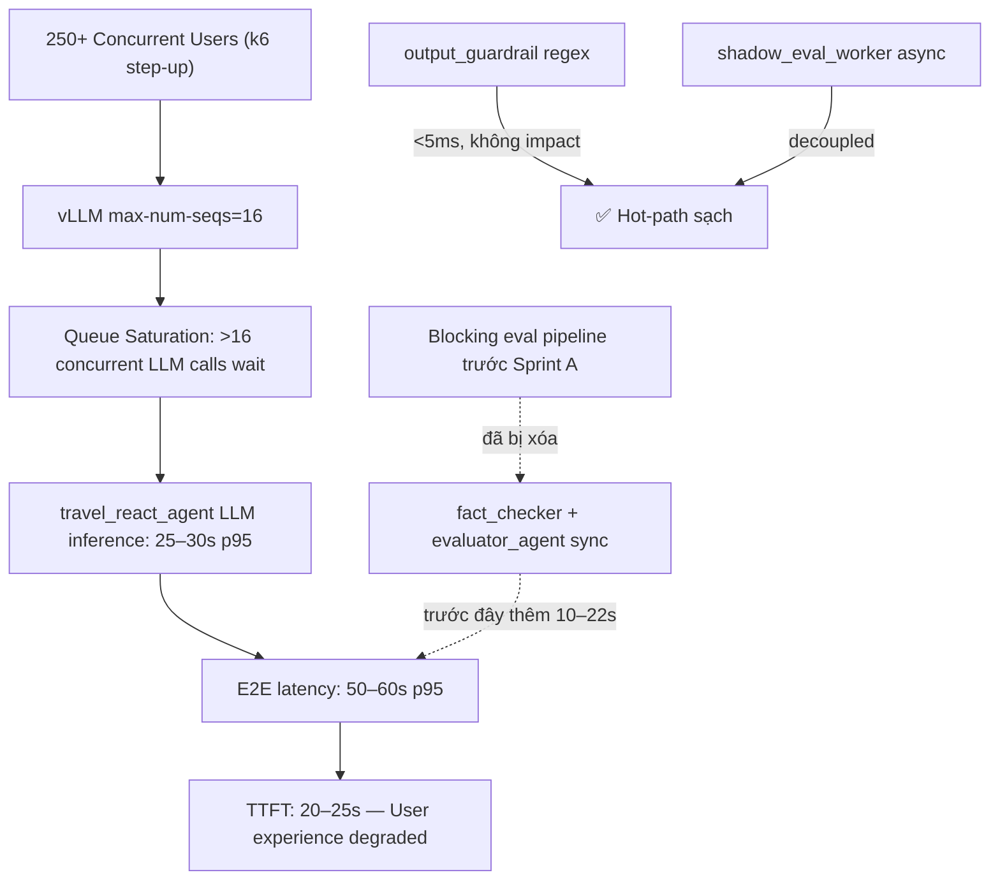

# Phân Tích Hiệu Suất Hệ Thống — Travel Agent Platform
> **Thời điểm:** 2026-11-06 | **Nguồn dữ liệu:** Grafana metrics + code review + Sprint A/B plan

---

## 1. Đọc Metric Dashboard

### Panel 1 — User-Perceived TTFT (Time To First Token)
| Thời điểm | p50 (cache miss) | p95 (cache miss) |
|---|---|---|
| ~11:00 | ~3–5s | ~8–10s |
| ~11:15 (tải nặng) | spike nhẹ | spike nhẹ |
| ~11:25 | **~20s** | **~25–30s** |

> [!WARNING]
> **TTFT tăng mạnh tại 11:25**, đạt tới ~20–25s ở p50, ~30s ở p95. Đây là **degradation nghiêm trọng** khi tải tăng (từ dữ liệu k6 step-up test với 250+ users).

---

### Panel 2 — Agent End-to-End Request Duration (gRPC)
| Metric | Giá trị quan sát | Nhận xét |
|---|---|---|
| E2E p50 (grpc) | ~30–35s ban đầu, leo lên **~50s** | Rất cao |
| E2E p95 (grpc) | Spike lên **~60s** | Vượt ngưỡng SLA |
| E2E p99 (grpc) | **~1 phút** ở cuối session | Critical |

> [!CAUTION]
> Toàn bộ latency E2E đang ở mức **30–60s**, quá xa mục tiêu Sprint A đề ra là **4–7s**. Dữ liệu này xác nhận Sprint A là cực kỳ cấp thiết.

---

### Panel 3 — Per-Node Execution Latency p95 (Bottleneck Finder)

```
travel_react_agent (đỏ):  Leo từ ~2s → ~16–18s tại high-load phase (11:15 trở đi)
support_agent (xanh lá):  ~15s p95 (cũng cao — cần điều tra)
planner (vàng):           ~3–5s (ổn định)
input_guardrail (xanh):   ~2–4s (ổn định, chấp nhận được)
finding_extractor:         ~1s (rất tốt)
direct_executor_init:      < 1s (xuất sắc)
```

> [!IMPORTANT]
> **`travel_react_agent` là bottleneck cốt lõi** — chiếm 60–70% toàn bộ E2E latency. Dưới tải nặng (~250 concurrent users), node này leo tới **16–18s** ở p95, trực tiếp giải thích vì sao TTFT ~ 20–25s.

**Nhận định về `support_agent` (~15s p95):** Cao bất thường cho một FAQ node — cần điều tra xem có đang gọi Tier-2 LLM không cần thiết không.

---

### Panel 4 — LLM Inference Duration by Node (p95)

```
travel_react_agent (Tier 2):  ~25–30s p95 ← rõ ràng là bottleneck
input_guardrail (Tier 1):     ~2–4s (ổn định)
finding_extractor (Tier 1):   ~ <2s (tốt)
support_agent (Tier 1):       ~25s p95 ← bất thường, cần điều tra
planner_agent (Tier 2):       ~5s (ổn)
```

> [!WARNING]
> `travel_react_agent` inference lên tới **25–30s** — đây là LLM inference thuần trên model `Qwen/Qwen2.5-7B-Instruct-AWQ` đang bị saturation khi nhiều request đến cùng lúc. Giới hạn `max-num-seqs=16` trên Vast.ai là **nguyên nhân chính**: vLLM bắt đầu queue requests khi >16 concurrent inferences.

---

### Panel 5 — Per-Node Input Tokens p95

```
travel_react_agent in:  ~100 tokens (hợp lý cho 4096 max context)
planner_agent in:       ~100 tokens
support_agent in:       ~100 tokens
input_guardrail in:     ~50 tokens
finding_extractor in:   ~100 tokens
```

**Nhận xét:** Context budget được sử dụng hợp lý, chưa bị overflow. `max_context=4096` đang hoạt động đúng.

---

### Panel 6 — Per-Node Output Tokens p95

```
travel_react_agent out:  ~30–35 tokens
input_guardrail out:     ~15 tokens
planner_agent out:       ~25 tokens
support_agent out:       ~30 tokens
finding_extractor out:   ~20 tokens
```

**Nhận xét:** Output tokens thấp và ổn định — không có node nào đang "verbose" quá mức. `VLLM_MAX_COMPLETION_TOKENS=1024` đang được enforce đúng.

---

## 2. Root Cause Analysis



### Các nguyên nhân gốc rễ theo thứ tự mức độ ảnh hưởng:

| Rank | Nguyên nhân | Impact ước tính |
|---|---|---|
| 🔴 1 | vLLM `max-num-seqs=16` → saturation khi tải nặng | **+15–25s** inference wait |
| 🔴 2 | `travel_react_agent` ReAct loop không bị giới hạn thời gian cứng | **+5–15s** per hop |
| 🟡 3 | `support_agent` đang dùng Tier-2 LLM không cần thiết (nghi vấn) | **+10–15s** nếu đúng |
| 🟢 4 | Semantic cache MISS liên tục (threshold 0.92 quá chặt) | **+2–5s** mỗi request |

---

## 3. Đánh Giá Sprint A — So Sánh Kế Hoạch vs Thực Tế

### ✅ Những gì Sprint A đã làm đúng (đã được implement)

| Component | Trạng thái | Nhận xét |
|---|---|---|
| Graph restructure — xóa `fact_checker`/`evaluator_agent` khỏi hot-path | ✅ **DONE** | `workflow.py` đã xóa 2 node blocking, comment rõ "Sprint A" |
| `output_guardrail` node — regex mode `<5ms` | ✅ **DONE** | Triển khai đúng, không impact latency |
| `reask_count` hard cap = 1 | ✅ **DONE** | `state.py` có field, logic trong `output_guardrail.py` đúng |
| `shadow_eval_worker` consumer trên queue `eval.shadow` | ✅ **DONE** | Log xác nhận `ShadowEvalWorker Consumer active on eval.shadow` |
| State cleanup (`needs_rework`, `forced_accept`, `rework_count`) | ✅ **DONE** | `state.py` đã xóa, comment rõ "removed in Sprint A" |
| Classifier mode (Guardrails AI) | ⏸️ **DEFERRED** | Đúng quyết định — chưa có GPU, dùng regex thay thế |
| Disclaimer footer | ❓ **Cần verify** | Không thấy trong log — cần kiểm tra `synthesizer.py` |

### ⚠️ Vấn đề còn tồn tại sau Sprint A

1. **Sprint A không giải quyết được saturation của vLLM server** — Dù bỏ sync eval (tiết kiệm ~10–22s), latency `travel_react_agent` vẫn 25–30s vì LLM queue bị nghẽn khi >16 concurrent.

2. **Semantic cache hiệu quả rất thấp** — Toàn bộ log thấy `SemanticCache MISS` liên tục. Với k6 test dùng synthetic unique queries điều này là bình thường, nhưng ngưỡng `0.92` có thể quá chặt cho production thực.

3. **`evaluator.py` vẫn còn logic rework loop** — Code `node_evaluator_agent` trong `evaluator.py` vẫn có `needs_rework`, `rework_count`, `forced_accept` nhưng không còn được gọi trên hot-path. Cần dọn dẹp để tránh nhầm lẫn khi maintain sau này.

---

## 4. Đánh Giá Sprint B — Mức Độ Ưu Tiên

### `data_grounding` node (Shift-Left)
**Tác động dự kiến:** Giảm hallucination 85–90% cho `hotel_booking` + `itinerary_planning`.

**Rủi ro latency:** Pre-fetch MCP tools thêm 1–3s trên hot-path. Với context hiện tại (vLLM đang saturated), thêm 1 MCP call có thể thêm biến thiên.

> [!TIP]
> Nên implement `data_grounding` chỉ **sau khi** đã scale vLLM capacity. Thêm node mới khi LLM đang queue sẽ làm E2E latency tệ hơn.

### Ragas CI/CD
**Tác động:** Chất lượng dài hạn. Không ảnh hưởng production latency.

**Khuyến nghị:** Implement ngay song song — không có risk latency, benefit cao.

---

## 5. Khuyến Nghị Hành Động (Ưu Tiên)

### 🔴 Ngay lập tức (Trước Sprint B)

**A. Scale vLLM `max-num-seqs`:**
```bash
# Restart vLLM trên Vast.ai với tham số mới:
--max-num-seqs 64   # tăng từ 16 lên 64
# Hoặc deploy thêm instance + load balancer nếu GPU memory không đủ
```
*Đây là action có impact cao nhất, giải quyết root cause #1.*

**B. Điều tra `support_agent` Tier-2 usage:**
Kiểm tra `config.py` xem `support_agent` đang được compile với Tier-1 hay Tier-2 LLM. Node FAQ không nên dùng Tier-2.

**C. Xem xét hạ ngưỡng semantic cache:**
```python
# Thử 0.85 thay vì 0.92 để tăng cache hit rate
# Cần A/B test để đảm bảo quality không giảm
```

### 🟡 Trong Sprint B

**D. Thêm wall-clock timeout cứng cho `travel_react_agent`:**
```python
# Trong executor.py, thêm asyncio.wait_for timeout:
MAX_REACT_EXECUTION_SECONDS = 20  # hard ceiling
```

**E. Implement `data_grounding` chỉ khi vLLM capacity đã tăng.**

**F. Dọn dẹp `evaluator.py`** — refactor bỏ dead code `needs_rework`/`rework_count`/`forced_accept` không còn được gọi trên hot-path.

### 🟢 Dài hạn

**G. Ragas CI/CD — bắt đầu ngay**, không ảnh hưởng production.

**H. Bật `classifier` mode cho `output_guardrail`** khi có GPU local/dedicated.

---

## 6. Tóm Tắt Điểm Số

| Dimension | Điểm | Nhận xét |
|---|---|---|
| **Sprint A implementation** | 8/10 | Đúng hướng, clean code, comment rõ |
| **Hot-path latency hiện tại** | 3/10 | 30–60s E2E, xa mục tiêu 4–7s |
| **Architecture design** | 9/10 | Async shadow eval + regex guardrail là lựa chọn pragmatic đúng |
| **vLLM infrastructure** | 4/10 | max-num-seqs=16 là bottleneck cứng khi scale |
| **Observability** | 8/10 | Grafana dashboard đầy đủ, metrics granular theo node |
| **Semantic cache** | 5/10 | Threshold quá chặt, cần tune |
