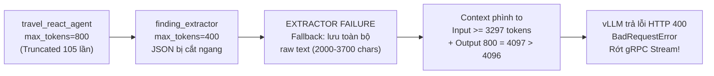

# Regression Test cho Option C

> **Tài liệu Kế hoạch Gốc:** [Implementation Plan — Option C: Priority Queue với RabbitMQ (`option-c-rabbitmq-plan.md`)](file:reports/performance_test/061126/option-c-rabbitmq-plan.md) ([Xem file tương đối](./option-c-rabbitmq-plan.md))

> **Branch kiểm thử:** `feat/async-queue-rabbitmq`

> **Commit kiểm thử:** `19d5dde` (`feat: add agent metrics, gRPC service layer, and RabbitMQ queue worker implementation`)

> **Thời gian chạy test:** `2026-11-10 11:51:33` – `12:11:23` (GMT+7) / `04:51:33` – `05:11:23` (UTC) (~20 phút)

> **Kịch bản Load Test:** `perf_grpc_stepup_heavy` (k6 gRPC Streaming Step-up Heavy Load)

> **Nguồn dữ liệu đánh giá:** 3 ảnh chụp Grafana Dashboards (Agent SLA & vLLM Engine) + Toàn bộ Runtime Log (`agent_platform.html` — 16,977 dòng log)

---

## 1. Cấu Hình Chạy Test Đầy Đủ (Test Environment & Configuration)

### 1.1. Hạ Tầng GPU & vLLM Serving ([`start_awq_kv_fp8.sh`](file:///C:/Users/tuanm/OneDrive/project2/Booking/agent/serving/vllm/configs/start_awq_kv_fp8.sh))

Hệ thống inference được triển khai trên **1x NVIDIA RTX 3090 (24 GB VRAM)** (vast.ai endpoint `77.48.24.250`), chạy song song 2 tiến trình vLLM:

| Thông số | Tiến trình 1: Chat / Reasoning LLM | Tiến trình 2: Embedding Server |
|---|---|---|
| **Model** | `Qwen/Qwen2.5-7B-Instruct-AWQ` | `Qwen/Qwen3-Embedding-4B` |
| **Endpoint** | `http://77.48.24.250:48669/v1` | `http://77.48.24.250:48989/v1` |
| **Quantization / Dtype** | `--quantization awq_marlin` / `--dtype float16` | `float16` (2560 dimensions) |
| **KV Cache Dtype** | `--kv-cache-dtype auto` (FP16 trên Ampere SM86) | N/A |
| **GPU Memory Utilization** | `--gpu-memory-utilization 0.50` (~12.0 GB VRAM) | `0.44` (~10.5 GB VRAM) |
| **Max Model Length (Context)** | `--max-model-len 4096` | Mặc định theo model |
| **Max Concurrent Sequences** | `--max-num-seqs 64` | Mặc định |
| **Chunked Prefill & Batching** | `--enable-chunked-prefill` / `--max-num-batched-tokens 512` | N/A |
| **Prefix Caching** | `--enable-prefix-caching` (Bật) | N/A |
| **Tool Call Parser** | `--enable-auto-tool-choice` / `--tool-call-parser hermes` | N/A |

---

### 1.2. Cấu Hình Agent Application, Concurrency & LangGraph ([`settings.py`](file:///C:/Users/tuanm/OneDrive/project2/Booking/agent/app/core/settings.py), [`concurrency.py`](file:///C:/Users/tuanm/OneDrive/project2/Booking/agent/app/core/concurrency.py), [`workflow.py`](file:///C:/Users/tuanm/OneDrive/project2/Booking/agent/app/graph/workflow.py))

| Nhóm Cấu Hình | Tham số / Thành phần | Giá trị lúc chạy test | Ghi chú |
|---|---|---|---|
| **Giao thức & Server** | gRPC Server (`grpc_server.py`) | `[::]:50051` (`tls_enabled=False`) | Chạy `StreamChat` RPC |
| | Prometheus Exporter | Port `8001` | Thu thập metrics cho Grafana |
| **LLM Provider & Tiers** | `llm_provider` | `vllm` | Dùng chung `Qwen/Qwen2.5-7B-Instruct-AWQ` cho cả 2 tiers |
| | `tier1` (Fast / Classification) | `temperature = 0.0`, `reasoning_effort = "none"` | Dùng cho `input_guardrail`, `support_agent`, `finding_extractor`, `clarification_agent` |
| | `tier2` (Balanced / Reasoning) | `temperature = 0.3`, `reasoning_effort = "none"` | Dùng cho `planner_agent`, `travel_react_agent`, `final_synthesizer` |
| **Concurrency Guard** | `TIER1_SEMAPHORE` | `16` concurrent calls | Giới hạn tại [`concurrency.py`](file:///C:/Users/tuanm/OneDrive/project2/Booking/agent/app/core/concurrency.py#L19) |
| | `TIER2_SEMAPHORE` | `12` concurrent calls | Giới hạn tại [`concurrency.py`](file:///C:/Users/tuanm/OneDrive/project2/Booking/agent/app/core/concurrency.py#L19) |
| **Option C (RabbitMQ)** | `use_llm_queue` (Feature Flag) | `False` (Mặc định) | Chưa bật `USE_LLM_QUEUE=true` trong `.env` |
| | `llm_requests_queue` | `llm.requests` (`x-max-priority=3`) | DLX: `dlx_llm_exchange`, DLQ: `llm_requests_dlq` |
| | `llm_result_ttl` | `300s` (Poll timeout: `120s`) | Lưu kết quả job trong Redis (`redis://redis_cache:6379/0`) |
| **Semantic Cache & RAG** | Qdrant Collections | `semantic_cache_vllm`, `hotels_collection_vllm` | Hybrid Retrieval (Dense 2560d + BM25 + RRF) |
| | Cache Similarity Threshold | `threshold = 0.92`, `top_k = 5` | Version anchor: `Qwen/Qwen2.5-7B-Instruct-AWQ` |
| **LangGraph Safeguards** | `MAX_ITERATIONS` / `MAX_TOOL_CALLS` | `8` iterations / `10` tool calls | `recursion_limit = 100` |
| | `guardrail_mode` | `regex` | Online `output_guardrail` (tối đa 1 lần re-ask) |
| | A/B Testing | `model_comparison_v1` | `model_a` (90%) / `model_b` (10%) |
| **Token Governance** | `max_context_tokens` | `4096` tokens | Khớp với `--max-model-len` của vLLM |
| (`NodeTokenLimits`) | `input_guardrail` / `support_agent` | `500` / `500` tokens | |
| | `planner_agent` | `600` tokens | |
| | `travel_react_agent` | `800` tokens | Node thực thi ReAct + gọi MCP/RAG tools |
| | `finding_extractor` | `400` tokens | Trích xuất JSON `ExecutorOutput` |
| | `final_synthesizer` | `1000` tokens | Tổng hợp câu trả lời Markdown cuối cùng |
| | `clarification_agent` | `200` tokens | |

---

## 2. Tổng Hợp Kết Quả Chạy Test

### 2.1. Bảng Chỉ Số Đo Lường Thực Tế Từ Grafana (Hình 1, 2, 3)

| Tầng Hệ Thống | Metric | Kết quả tại Đỉnh tải (~12:08) | Kết quả khi Kết thúc (~12:10) | Đánh giá |
|---|---|---|---|---|
| **Traffic & Streams** | Active SSE Streams (HTTP) | `0` | `0` | Test tập trung vào luồng gRPC |
| | Active gRPC Streams | **`251` streams** (Đỏ) | `0` | Server chịu tải kết nối tốt, không crash, nhưng bị dồn ứ (backlog) lớn |
| | Agent Request Rate | **`8.40 req/s`** | `6.11 req/s` | Tải đầu vào cao (>559 sessions) |
| | Semantic Cache Hit Rate (5m) | `15.0%` | `10.8%` | Hoạt động đúng thiết kế |
| **Agent SLA & Latency** | User-Perceived TTFT p95 (Cache Hit) | **~`0.5s – 0.8s`** | **~`0.5s – 0.8s`** | Rất nhanh |
| | User-Perceived TTFT p95 (Cache Miss) | **`≥ 20.0s`** (Chạm trần bucket) | **`≥ 20.0s`** (Chạm trần bucket) | Quá cao do phải chờ xong toàn bộ các bước trước `final_synthesizer` |
| | Agent E2E Duration p50 | `< 2s` (đầu test) ➔ **`≥ 60s`** (cuối test) | **`≥ 60s`** (lúc xả backlog) | Backlog 251 streams làm p50 tăng vọt ở cuối bài test |
| | Agent E2E Duration p95 / p99 | **`≥ 60.0s`** (Chạm trần 1 min) | **`≥ 60.0s`** (Chạm trần 1 min) | Vượt SLA mục tiêu |
| **Node & Governance** | Per-Node Latency p95 (`travel_react_agent`) | **`≥ 20.0s`** (Chạm trần) | **`≥ 20.0s`** (Chạm trần) | Các node khác (`planner`, `guardrail`, `extractor`) giảm về `5s–10s` sau phút `11:58` |
| | LLM Inference Duration p95 (`travel_react_agent`) | **`≥ 30.0s`** (Chạm trần) | **`≥ 30.0s`** (Chạm trần) | **Bao gồm thời gian chờ `TIER2_SEMAPHORE`** |
| | **Truncated Node Outputs** | **`102`** (Đỏ) | **`105`** (Đỏ) | Quá nhiều lần bị cắt ngang ở `800` / `400` tokens |
| | Safeguard Forced Terminations | `1` | `1` | Kiểm soát vòng lặp tốt |
| **vLLM Engine (GPU)** | **KV Cache Usage %** | **`5% – 12%`** | `0%` | **GPU thừa ~90% bộ nhớ KV Cache** |
| | **Preemption Rate** | **`0` preemptions/s** | `0` | Không hề bị tràn hay swap KV Cache |
| | vLLM Request Queue Depth (`Running`) | Trung bình **`5 – 15`** (Peak: `28`) | `0` | Chưa dùng hết `max-num-seqs=64` |
| | vLLM Request Queue Depth (`Waiting`) | **`0`** (chỉ nhú `3–10` lúc `11:52`) | `0` | **Không có hàng đợi tại vLLM** |
| | vLLM Native TTFT (p50 / p95 / p99) | **`< 0.5s – 1.0s`** (sau burst đầu) | `< 0.5s` | vLLM prefill rất nhanh |
| | vLLM ITL / TPOT (p50 / p95 / p99) | `12ms` / `25–45ms` / `80–130ms` | — | Tốc độ sinh token ổn định |
| | vLLM Generation Token Throughput | **`450 – 850 tok/s`** | — | Hiệu suất giải mã AWQ Marlin rất tốt |
| | **vLLM E2E Latency (p50 / p95)** | **`~1.5s` (p50) / `~4.5s – 7.5s` (p95)** | — | **vLLM xử lý rất nhanh, `Queue Wait p95 = 0ms`** |

---

## 3. Phân Tích Nguyên Nhân Gốc Rễ (Root-Cause Analysis)

### 3.1. Phát hiện số 1: Luồng Option C (RabbitMQ Priority Queue) CHƯA chạy trong bài test và `worker_main.py` bị lỗi `NameError`
Đối chiếu [`option-c-rabbitmq-plan.md`](file:///C:/Users/tuanm/OneDrive/project2/Booking/docs/reports/performance_test/061126/option-c-rabbitmq-plan.md) với log thực tế trong `agent_platform.html`:
1. **Lỗi thiếu `import` trong [`worker_main.py`](file:///C:/Users/tuanm/OneDrive/project2/Booking/agent/app/worker_main.py#L133-L136):**
   * Dòng 133–134 gọi `_llm_redis = AsyncRedis.from_url(settings.redis.url)` và `asyncio.create_task(run_llm_worker(_llm_redis))` nhưng đầu file chưa import `AsyncRedis` và `run_llm_worker`.
   * Trong log `agent_platform.html` (dòng 120–122, lúc `04:45:28`), ngay sau khi khởi chạy `ShadowEvalWorker`, tiến trình `WorkerMainCore` văng lỗi `NameError` và dừng hoạt động. Do đó consumer `llm.requests` chưa bao giờ được kích hoạt, và các sự kiện `eval.shadow` cũng không được xử lý trong suốt bài test.
2. **Feature Flag `use_llm_queue` đang ở giá trị mặc định `False`:**
   * Toàn bộ bài test chạy qua nhánh **Sync Semaphore** (`run_graph_stream`) trong [`chat_stream_service.py`](file:///C:/Users/tuanm/OneDrive/project2/Booking/agent/app/services/streaming/chat_stream_service.py#L370-L380).

### 3.2. Phát hiện số 2: Nghẽn cổ chai giả tạo tại `TIER2_SEMAPHORE = 12` (Tại sao vLLM mất 5s nhưng Agent báo 30s?)
* Trên **Hình 3 (vLLM Engine)**: `LLM E2E p95` chỉ mất **4.5s – 7.5s** và `Queue Wait p95` trên vLLM bằng **0ms**. Số lượng request `Running` trên vLLM chỉ dao động **5 – 15 requests**, KV Cache mới dùng **8%**.
* Trên **Hình 2 (Agent SLA)**: `LLM Inference Duration by Node p95` của `travel_react_agent` lại chạm trần **30s**.
* **Nguyên nhân:** Hàm [`invoke_llm_with_limit()`](file:///C:/Users/tuanm/OneDrive/project2/Booking/agent/app/graph/config.py#L227-L242) bắt đầu bấm giờ (`start_ts`) **trước khi** vào `async with sem:`. Khi có 251 gRPC streams đồng thời, các coroutine phải đứng xếp hàng chờ 12 vé của `TIER2_SEMAPHORE` ở tầng Python mất **22s – 25s**, trong khi thời gian thực thi trên GPU vLLM chỉ mất **5s**.

### 3.3. Phát hiện số 3: Chuỗi lỗi dây chuyền (Cascading Failure) gây ra 105 Truncations & Lỗi HTTP 400 Context Overflow
Từ file log `agent_platform.html`, một chuỗi lỗi dây chuyền đã xảy ra như sau:



1. **Truncation ở `finding_extractor` (`400` tokens):** Khi `travel_react_agent` sinh văn bản dài (tới 800 tokens), `finding_extractor` cần đóng gói JSON (`result_summary` + mảng `findings`). Ngưỡng `400` tokens quá nhỏ khiến JSON bị cắt cụt giữa chừng:
   * `❌ [EXTRACTOR FAILURE] Falling back to raw executor text. Trace: Could not parse response content as the length limit was reached` (dòng 8502, 8598, 16272, 16719, 16800...).
2. **Fallback làm mất `findings` và làm phình bộ nhớ:** Khi parse JSON thất bại, `findings` bị gán rỗng `[]` (làm các task sau mất `PRIOR TASK FINDINGS`) và toàn bộ `executor_raw` (dài tới 3,788 ký tự) bị đẩy thẳng vào `task["result"]`.
3. **Lỗi tính toán trong [`prune_messages_by_token_limit`](file:///C:/Users/tuanm/OneDrive/project2/Booking/agent/app/graph/utils.py#L69-L108) & [`executor.py`](file:///C:/Users/tuanm/OneDrive/project2/Booking/agent/app/graph/nodes/executor.py#L176-L180):**
   * Trước khi sửa, `executor.py` truyền trực tiếp `provider_cfg.max_context_tokens` (`4096`) vào `prune_messages_by_token_limit` mà **không trừ đi ngân sách dành cho `max_tokens_override` (`800`) và Hermes tool schemas (`~800 tokens`)**.
   * Hệ quả: Khi input đạt `3297` tokens, tổng `3297 (input) + 800 (requested output) = 4097 > 4096`, khiến vLLM trả lỗi **HTTP 400 BadRequestError** (dòng 16377, 16782, 16784, 16835) và làm đứt gãy stream của user.

### 3.4. Phát hiện số 4: Planner sinh quá nhiều Tasks (10–14 tasks)
* Dù prompt của [`node_planner_agent`](file:///C:/Users/tuanm/OneDrive/project2/Booking/agent/app/graph/nodes/planner.py#L30) yêu cầu chia thành `2-4 concrete, sequential sub-tasks`, nhưng không có giới hạn cứng trong code nên model đôi khi sinh tới **10 – 14 tasks** (dòng 16203, 16291, 16897) và gọi **15 `search_web` liên tiếp** (dòng 16257), khiến 1 request đơn lẻ chiếm dụng GPU qua hàng chục vòng lặp.

---

## 4. Hướng Đề Xuất Fix & Các Thay Đổi Đã Áp Dụng

Toàn bộ các điểm nghẽn trên đã được khắc phục trên nhánh `feat/async-queue-rabbitmq` với cấu hình so sánh trước và sau như sau:

### 4.1. Bảng So Sánh Cấu Hình Trước & Sau Khi Fix

| Hạng mục | File | Trước khi Fix (Bản chạy test) | Sau khi Fix (Đã cập nhật) | Tác động kỳ vọng |
|---|---|---|---|---|
| **Worker Imports** | [`worker_main.py`](file:///C:/Users/tuanm/OneDrive/project2/Booking/agent/app/worker_main.py#L9-L11) | Thiếu `run_llm_worker`, `AsyncRedis` (Crash `NameError`) | Đã thêm đầy đủ 2 dòng `import` | Khôi phục hoàn toàn `eval.shadow` và `llm.requests` consumers |
| **vLLM Context Length** | [`start_awq_kv_fp8.sh`](file:///C:/Users/tuanm/OneDrive/project2/Booking/agent/serving/vllm/configs/start_awq_kv_fp8.sh#L23)<br>[`settings.py`](file:///C:/Users/tuanm/OneDrive/project2/Booking/agent/app/core/settings.py#L71) | `--max-model-len 4096`<br>`max_context_tokens = 4096` | **`--max-model-len 8192`**<br>**`max_context_tokens = 8192`** | Tận dụng 6.8 GB VRAM KV Cache đang trống (~90%), loại bỏ hoàn toàn lỗi HTTP 400 |
| **vLLM Batched Tokens** | [`start_awq_kv_fp8.sh`](file:///C:/Users/tuanm/OneDrive/project2/Booking/agent/serving/vllm/configs/start_awq_kv_fp8.sh#L26) | `--max-num-batched-tokens 512` | **`--max-num-batched-tokens 1024`** | Tăng tốc độ Chunked Prefill cho prompt dài |
| **vLLM Semaphore** | [`concurrency.py`](file:///C:/Users/tuanm/OneDrive/project2/Booking/agent/app/core/concurrency.py#L19) | `tier1: 16, tier2: 12` (Tổng: 28) | **`tier1: 24, tier2: 24`** (Tổng: 48) | Tăng gấp đôi băng thông Tier 2, giảm thời gian chờ Semaphore ở Python |
| **Node Token Limits** | [`settings.py`](file:///C:/Users/tuanm/OneDrive/project2/Booking/agent/app/core/settings.py#L160-L165) | `travel_react_agent = 800`<br>`finding_extractor = 400`<br>`final_synthesizer = 1000` | **`travel_react_agent = 1200`**<br>**`finding_extractor = 800`**<br>**`final_synthesizer = 1536`** | Chấm dứt lỗi `EXTRACTOR FAILURE` và giảm mạnh `Truncated Node Outputs` mà không làm mất ngữ cảnh |
| **Context Pruning** | [`executor.py`](file:///C:/Users/tuanm/OneDrive/project2/Booking/agent/app/graph/nodes/executor.py#L176-L180)<br>[`utils.py`](file:///C:/Users/tuanm/OneDrive/project2/Booking/agent/app/graph/utils.py#L69-L108) | Truyền `max_context_tokens` thô; có nguy cơ cắt mất `SystemMessage` / `HumanMessage` | Trừ ngân sách output + tool schemas (`- 2100 tokens`); **ghim cố định `SystemMessage` + `HumanMessage` đầu tiên**; lọc bỏ `ToolMessage` mồ côi | Không bao giờ vượt trần context của vLLM và luôn bảo toàn câu hỏi gốc của user |
| **Planner Task Cap** | [`planner.py`](file:///C:/Users/tuanm/OneDrive/project2/Booking/agent/app/graph/nodes/planner.py#L43) | Không giới hạn (`plan.tasks`) | Giới hạn cứng **`plan.tasks[:4]`** | Ngăn chặn các trường hợp sinh 10–14 tasks gây treo stream > 60s |
| **Prometheus Buckets** | [`metrics.py`](file:///C:/Users/tuanm/OneDrive/project2/Booking/agent/app/core/metrics.py#L40-L173) | Trần `20s` (TTFT/Node), `30s` (LLM), `60s` (E2E), `4096` (Tokens) | Mở rộng lên **`60s` (TTFT/Node/LLM)**, **`180s` (E2E)**, **`8192` (Tokens)** | Biểu đồ Grafana p95/p99 phản ánh đúng giá trị thực, không bị cắt phẳng |

---

### 4.2. Hướng Dẫn Các Bước Chạy Lại Regression Test

1. **Khởi động lại vLLM trên GPU vast.ai với script mới:**
   ```bash
   bash agent/serving/vllm/configs/start_awq_kv_fp8.sh
   ```
   *(Xác nhận log vLLM in ra `max-len=8192` và `--max-num-batched-tokens 1024`).*
2. **Kiểm tra biến môi trường `.env` của Agent:**
   * Đảm bảo không có dòng `VLLM_MAX_CONTEXT_TOKENS=4096` ghi đè trong `.env` (hoặc cập nhật thành `8192`).
3. **Rebuild và khởi chạy lại các Docker containers:**
   ```bash
   docker compose build
   docker compose up -d
   ```
4. **Xác nhận `agent-worker` hoạt động bình thường:**
   * Kiểm tra log container worker có dòng:
     `🎧 Consumers active: [fact_extraction_queue] + [hotel_sync_queue] + [eval.shadow] + [llm.requests]`
     và `[LlmWorker] Consumer active on 'llm.requests' (prefetch=24).`
5. **Chạy lại kịch bản k6 `perf_grpc_stepup_heavy` và kiểm tra 4 tiêu chí nghiệm thu trên Grafana:**
   * [ ] **Lỗi HTTP 400 Context Overflow:** Giảm về **`0`** trong log.
   * [ ] **`EXTRACTOR FAILURE` & `Truncated Node Outputs`:** Giảm từ `105` xuống tiệm cận **`0`**.
   * [ ] **vLLM Running Queue Depth:** Tăng từ mức trung bình `5–15` lên `15–30+` nhờ mở rộng `TIER2_SEMAPHORE = 24`.
   * [ ] **Agent E2E Request Duration p50 / p95:** Giảm mạnh nhờ cắt trần 4 tasks ở Planner và giảm thời gian chờ Semaphore.
